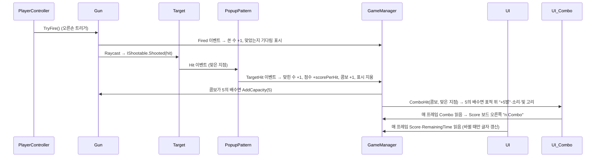
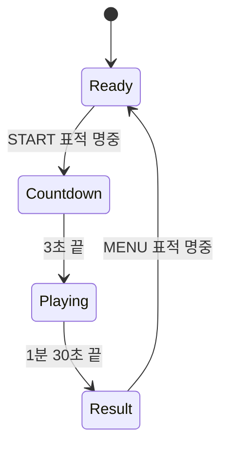

# Quick Draw 개발 설계서

Nov 17, 2026 · 기준 문서: [Concept_Doc.md](Concept_Doc.md)

## 0. 요약

- **환경**: Unity 6000.3.15f1 · URP · XR Interaction Toolkit 3.5.1 (Starter Assets의 XR Origin) · OpenXR
- **작업 범위**: 모든 파일은 `Assets/QuickDraw` 안에 둡니다. 프로젝트 설정(레이어)만 예외입니다.
- **코드 작성 원칙**: 코드는 `/karpathy-skill:karpathy-skill` 스킬을 참조해서 간결하게 수정합니다. 가정은 먼저 밝히고, 필요한 만큼만 쓰고, 요청한 부분만 고치고, 확인 방법을 정한 뒤 끝냅니다.
- **설계 원칙**: 코드는 최대한 간결하게 씁니다. 수치는 그 값을 쓰는 스크립트의 Inspector 필드(`[SerializeField]` + 기본값)로 두고, 데이터 파일이나 데이터 전용 클래스는 만들지 않습니다. 입력 바인딩은 코드에서 `AddBinding`으로 겁니다.
- **손 역할**: 총은 항상 오른손, 탄창은 항상 왼손으로 잡습니다.
- **상호작용**: 잡기는 XRI(Near-Far Interactor 근접)가, 발사와 탄창 빼기 입력은 `PlayerController`가 맡아 `Gun`에 전달합니다. 쥔 탄창을 빈 총 아래에 대면 끼워질 자리에 반투명 가이드가 보이고, 손을 놓으면 끼워져 바로 쏠 수 있습니다. A 버튼은 탄을 다 쓴 탄창만 뺍니다 (3.5).
- **진행 상황**: M0~M5(기반, 총, 탄창, 표적, 게임 흐름, 단계 난이도) 완료. 한 판은 START 뒤 3초 카운트다운, 이어서 쉬는 시간 없는 90초입니다. 표적은 단계마다 넓어지는 범위 안 무작위 위치에 나오고, 1단계 팝업 → 2단계 이동 표적·웨이브 → 3단계 다가오는 표적으로 패턴이 늘어납니다. 5연속 명중마다 탄창이 5발씩 늘어나는 콤보가 있습니다(M7). 자동 테스트는 두지 않고 Play 모드(시뮬레이터)나 헤드셋에서 직접 확인하며, 실제 기기 확인이 남았습니다(7.1). 다음은 M6(다듬기)입니다 (7장).

---

## 1. 수치 (Inspector 기본값)

수치는 아래 스크립트의 Inspector에서 바로 고칩니다. *기울임* 값은 기획서에 없어서 넣은 **제안값**입니다.

| 스크립트 | 필드 | 기본값 |
| --- | --- | --- |
| `GameManager` | `countdownDuration` (START 뒤 카운트다운, 끝나면 게임 시작) | 3초 |
| | `gameDuration` (한 판, 쉬는 시간 없음. 단계 수로 똑같이 나눔 → 30초씩) | 90초 |
| | `scorePerHit` | 10 |
| | `comboStep` / `comboBonusAmmo` (이만큼 연속으로 맞힐 때마다 / 늘어나는 탄 수) | 5연속 / 5발 |
| `Gun` | `effectRange` | 30 m (가장 먼 표적 15m보다 길게) |
| | `magazineCapacity` (탄창 1개 기본 탄 수. 콤보 보너스가 그 판 동안 더해짐) | 10발 |
| | `hapticAmplitude` / `hapticDuration` | *0.7* / *0.08초* |
| `LaserSight` | `width` (색은 `M_Laser` 머티리얼, 빨강) | *0.003m* |
| | `dotScale` (거리 1m당 조준점 지름) | *0.005* (15m에서 7.5cm) |
| `ReturnToSpawn` | `returnDelay` | 2초 |
| `Magazine` | `droppedLifetime` (다 쓴 탄창을 뺀 뒤 사라지기까지) | 5초 |
| | `insertDistance` (끼울 자리에서 이만큼 안이면 가이드, 놓으면 끼움) | *0.1m* |
| `MagazineSpawner` | `respawnDelay` (자리가 빈 뒤 새 탄창이 놓이기까지) | *0.3초* |
| | `leaveDistance` (놓은 탄창이 자리에서 수평으로 이만큼 넘게 벗어나면 빈 자리) | *0.05m* |
| | `slots` (탄창 자리, 자식 Transform) | *3개: (-0.29, 1.01, 0.55)에서 -X로 10cm 간격, 눕힌 방향. 테이블 윗면보다 약 12cm 위라 떨어져 놓임* |
| `Target` | `riseTime` (일어나기·쓰러지기 시간) | *0.2초* |
| | `moveSpeedRange` / `moveWidthRange` (이동 표적마다 고르는 속도 / 왕복 폭의 범위) | 1~2.5m/s / 1~3m |
| | `approachSpeed` (다가오는 표적의 속도) | 3m/s |
| `PopupPattern` | `targetRadius` (단계별, 길이 = 단계 수) | 0.5 / 0.35 / 0.25 m |
| | `spawnAngle` (단계별 좌우 등장 범위, 정면에서 한쪽 각도) | ±25 / ±35 / ±45° |
| | `targetCount` / `targetLifetime` (단계별 동시에 서 있는 최대 수 / 서 있는 시간) | 3 / 4 / 5개 · 1.5 / 1.2 / 1초 |
| | `lifetimeJitter` (서 있는 시간을 표적마다 이 비율까지 늘이거나 줄임) | 0.3 (±30%) |
| | `movingChance` / `approachChance` (단계별 이동 표적 / 다가오는 표적 비율) | 0 / 0.4 / 0.4 · 0 / 0 / 0.2 |
| | `waveCount` (단계별 웨이브 때 한꺼번에 세우는 수, 0이면 웨이브 없음) | 0 / 3 / 5개 |
| | `distanceRange` / `heightRange` (등장 거리 / 원판 중심 높이, 모든 단계 같음) | 5~15m / 1~2.5m |
| | `approachStart` (다가오는 표적이 나오는 거리. 끝은 `distanceRange` 최소 5m) | 12~15m |
| | `refillDelay` (맞히거나 쓰러진 뒤 새 표적까지, 그 범위 안 무작위) | 0.2~0.8초 |
| | `avoidDistance` (방금 표적이 사라진 곳에서 이 안에는 안 나옴) | 2m |
| | `waveInterval` / `waveLifetime` (웨이브 간격 / 웨이브 표적이 서 있는 시간) | 10초 / 2.5초 |
| `UI_Combo` | `popScale` / `popTime` (콤보 글자·"+n발"이 튀어나오는 크기 / 1배로 돌아오는 시간) | *1.4배* / *0.15초* |
| | `bonusScale` / `bonusColors` (5연속을 넘은 콤보 글자와 "+n발" 크기 / 단계별 색 5·10·15·20…, 넘으면 마지막 색) | *1.5배* / 노랑·주황·빨강·보라 |
| | `popupLift` / `popupDuration` / `popupRise` / `fadeStart` ("+n발"을 맞은 지점 위로 띄우는 높이 / 떠 있는 시간 / 올라가는 높이 / 흐려지기 시작하는 비율) | *0.5m* / 0.8초 / *0.3m* / *0.6* |
| | `sizePerMeter` (머리까지 거리 1m당 "+n발" 글자 크기 배율) | *0.4* |
| | `pitchStep` / `burstScaleStep` (단계마다 높아지는 보너스 소리 / 커지는 이펙트) | *0.1배* / *0.25배* |
| | `burstSizePerMeter` (머리까지 거리 1m당 이펙트 크기 배율) | *0.12* (15m에서 1.8배) |
| `PopupPattern` | `positionTries` (겹치지 않는 위치를 찾아 다시 고르는 횟수) | *10번* |
| | `blockMask` (표적을 가리거나 묻으면 안 되는 배경 물체의 레이어) | Default |

- 좌표는 월드 좌표입니다. XR Origin이 (0, 0, 0)에서 +Z를 보므로 z가 곧 정면 거리입니다 (5~15m). 각도는 원점에서 +Z 기준 좌우입니다.
- 범위 값(`…Range`, `distanceRange` 등)은 `Vector2`(최소, 최대)로 둡니다.
- 기획서 값은 3·2·1 카운트다운, 한 판 1분 30초(쉬는 시간 없음, 30초마다 단계), +10점, 5연속마다 +5발, 탄창 10발, 놓친 총 복귀 2초, 다 쓴 탄창 5초 뒤 제거, 표적 거리 5~15m·높이 1~2.5m, 단계별 크기·좌우 범위·동시 수·서 있는 시간(±30%), 새 표적까지 0.2~0.8초, 방금 사라진 곳 2m, 이동 표적(약 40%, 1~2.5m/s, 1~3m), 웨이브(약 10초마다 3·5개, 2.5초), 다가오는 표적(약 20%, 12~15m에서 3m/s, 5m에서 쓰러짐), 콤보 숫자 약 0.8초입니다.

### 1.1 입력 바인딩

입력 에셋(`.inputactions`)은 만들지 않고, `PlayerController.OnEnable()`에서 `new InputAction(...)` + `AddBinding(...)`으로 XR 바인딩과 PC 테스트 바인딩을 함께 겁니다. 잡기(그립)는 XRI 기본 입력이 이미 처리하므로 따로 만들지 않습니다.

| 액션 | 용도 | XR 바인딩 | PC 테스트 바인딩 |
| --- | --- | --- | --- |
| `ShootAction` | 발사. UI 버튼(START / MENU)도 쏴서 누름 | `<XRController>{RightHand}/{TriggerButton}` | `<Mouse>/leftButton` |
| `MagOutAction` | 탄창 제거 | `<XRController>{RightHand}/{PrimaryButton}` (A) | `<Keyboard>/r` |

---

## 2. 시스템 (MonoBehaviour)

한 판 동안 바뀌는 값은 그 값을 쓰는 스크립트가 직접 들고 있습니다. 다른 스크립트는 이벤트를 받아 읽기만 합니다.

| 스크립트 | 하는 일 | 가진 값 |
| --- | --- | --- |
| `GameManager` | 단계 전환(`StartGame()`·`ReturnToMenu()`), 카운트다운·게임 시간, 30초마다 표적 단계(`popup.Begin(단계)`), 점수·명중률·콤보 집계, 콤보 보너스(`gun.AddCapacity`), `PopupPattern` 시작·종료, 메뉴로 돌아갈 때 총 비우기. `PhaseChanged`, `ComboHit` 이벤트 | `Phase`(`GamePhase`: Ready·Countdown·Playing·Result), `RemainingTime`(Countdown이면 카운트다운, Playing이면 게임의 남은 시간), `Score`, `ShotCount`, `HitCount`, `Accuracy`, `Combo` |
| `PlayerController` | 입력. 오른손 트리거 → 든 총의 `TryFire()`, 오른손 A → `TryEjectMagazine()` | 없음 (든 총은 오른손 `NearFarInteractor`에서 바로 읽음) |
| `PlayerMoveLock` | PC 테스트용 XR 시뮬레이터에서 제자리를 지킴: FPS 모드의 WASD 이동과 Point-and-Click을 끔 (헤드셋 이동은 씬 설정으로 이미 막혀 있음) | 시뮬레이터 원래 이동 배율, Point-and-Click 사용 여부 |
| `Gun` | `TryFire()`·`TryEjectMagazine()`(A, 0발일 때만)·`EjectMagazine()`(메뉴 복귀, 항상)·`InsertMagazine()`, 콤보 보너스 `AddCapacity(n)`(지금 탄 +n, 앞으로 끼울 탄창 +n)·`ResetCapacity()`(메뉴로 돌아갈 때), 매 프레임 조준 레이캐스트(`AimTarget`, 쏠 때는 다시 겨눠 판정), 연출 | `Ammo`, `HasMagazine`, 그 판의 보너스 탄 수 |
| `LaserSight` | 잡혀 있을 때 총구에서 조준선과 점 표시 | 없음 |
| `UI_Gun` | 총 뒤쪽 남은 탄 숫자 (`Gun.AmmoChanged` 구독) | 없음 |
| `ReturnToSpawn` | 손에서 놓친 뒤 2초 안에 다시 잡히지 않으면 처음 놓여 있던 자리(테이블)로 복귀, 다시 잡으면 취소 | 시작 위치·회전, 복귀 코루틴 |
| `SnapGuide` | 손이 가까이 오면 잡힐 자리에 반투명 미리보기 표시 (3.2) | 미리보기 오브젝트 |
| `Magazine` | 손에 든 채 빈 총의 끼울 자리 근처면 그 자리에 반투명 가이드, 거기서 놓으면 `Gun.InsertMagazine(this)` → `AttachTo(socket)`로 총의 자식이 됨. 빼면 `Drop()`으로 떨어지고 다시 못 잡으며 `droppedLifetime` 뒤 제거. 씬의 Gun은 모든 탄창이 한 번 찾아 같이 씀 | 끼울 자리 가이드, 끼우기 요청 |
| `MagazineSpawner` | 시작할 때 자리마다 탄창을 놓고, 그 탄창이 집혀 가거나 밀려나거나 사라지면 `respawnDelay` 뒤 그 자리에 새 탄창 (3.5) | 자리마다 놓은 탄창, 자리가 빈 채로 지난 시간 |
| `IShootable` | 총에 맞을 수 있는 물체의 인터페이스: `Shooted(RaycastHit hit)` (총의 조준 레이캐스트가 맞은 지점) | |
| `Target` | `Show(원판 중심, 반지름, 움직임)`(일어남. 움직임 `Target.Motion`: None·Horizontal·Vertical·Diagonal·Approach)·`Hide()`(바로 사라짐)·`Fall()`(쓰러진 뒤 사라짐), 원형 명중 판정, `Hit` 이벤트(맞은 지점 포함) | `IsStanding`, 이동 표적마다 고른 속도·폭 |
| `PopupPattern` | 게임의 모든 표적과 단계별 표적 수치. 단계별 범위 안 무작위 위치에 나타났다 쓰러짐, 맞히거나 쓰러지면 바로 채움, 일부는 이동·다가옴, 간격마다 웨이브. `Begin(단계)`, `End()`, `StageCount`, `TargetHit(맞은 지점)` 이벤트, 등장 범위 기즈모. `Target.prefab`은 필요할 때 만들어 돌려 씀 | 표적마다 쓰러질 시각·웨이브 여부, 방금 사라진 곳 |
| `UI_Combo` | Score 보드 오른쪽 `ComboText`에 2연속부터 "n Combo"(오를 때 튀어나옴, 5연속을 넘으면 단계 색·큰 글자). `GameManager.ComboHit`를 받아 5의 배수에만 맞힌 표적 위 "+5발", 탄피 소리, 빛 고리 이펙트 (2.4) | 표시 중인 콤보, 마지막으로 오른 시각 |
| `UI` | World Space UI. `PhaseChanged`를 받아 Menu / Countdown / Score / Result 중 하나만 보임. Countdown은 남은 카운트다운을 큰 숫자(3·2·1)로 보이고 숫자가 바뀔 때와 게임이 시작될 때 소리를 냄(2.2). Score는 남은 시간(`m:ss`)과 점수만(바뀔 때만 글자 갱신), Result는 점수·명중률과 MENU 버튼만 표시. `UI` 루트가 `IShootable`이고, 맞은 콜라이더가 START면 `StartGame()`, MENU면 `ReturnToMenu()`, 튜토리얼 보드면 이스터에그 적중 수를 셈. Ready에서는 튜토리얼 보드도 보임 | 튜토리얼 적중 수 |

정한 규칙:

- 쏜 수와 맞힌 수는 **Playing 단계에서만** 셉니다. Ready, Countdown, Result에서 쏜 탄(START, MENU, 카운트다운 중 쏜 탄 포함)은 명중률에 들어가지 않습니다.
- 명중률 = 맞힌 수 ÷ 쏜 수 (0발이면 0).
- 매 판은 빈 총(탄창 없음)으로 시작합니다. MENU로 메뉴에 돌아가면 꽂힌 탄창을 빼고 남은 탄을 버립니다.
- START를 쏜 1발도 탄창에서 빠지고 탄이 남은 탄창은 A로 뺄 수 없으므로, 게임은 9발 이하로 시작합니다 (튜토리얼 보드를 쐈으면 더 적음).
- 결과 화면이 될 때 0발이면 새 탄창을 끼워 MENU를 쏩니다. 그 탄창도 메뉴로 돌아갈 때 남은 탄과 함께 빠집니다.
- 탄창을 끼우면 바로 쏠 수 있습니다 (`Ammo = magazineCapacity + 그 판의 보너스 탄 수`, 기본 10발).
- 콤보는 **Playing 단계에서만** 셉니다. 표적을 맞히면 +1, 표적에 맞지 않은 탄(아무것도 안 맞음, 테이블·바닥, 쓰러지는 중인 표적)을 쏘면 0. 놓쳐서 쓰러진 표적과 딸깍은 콤보를 바꾸지 않습니다.
- 콤보가 `comboStep`(5)의 배수가 되면 `gun.AddCapacity(comboBonusAmmo)`: 지금 탄 +5, 그 판 동안 앞으로 끼울 탄창 +5. 상한은 없고, 콤보가 끊겨도 보너스는 그 판 끝까지 갑니다. 메뉴로 돌아가면(→ Ready) 보너스는 0으로 돌아가, 메뉴에서 끼우는 탄창부터 다시 10발입니다.
- 탄창이 없거나 탄이 0발일 때 방아쇠를 당기면 딸깍 소리만 나고 쏜 수에 들어가지 않습니다.
- A 버튼(`TryEjectMagazine`)은 탄이 0발일 때만 탄창을 뺍니다. 탄이 남아 있으면 아무 일 없습니다(로그만).
- 메뉴 복귀(`EjectMagazine`)는 탄이 남아 있어도 빼고, 남은 탄은 버립니다 (`Ammo = 0`).
- 쓰러져 있는 표적은 맞혀도 점수가 없습니다.

### 2.1 시스템끼리 연결

`Gun`은 **`Fired`를 레이캐스트 처리보다 먼저** 보냅니다. 그래서 쏜 탄은 맞힌 대상이 단계를 바꾸기 전의 단계에서 셉니다 (START를 쏜 탄은 Ready, 마지막 표적을 맞힌 탄은 Playing).

빗나감은 이 순서로 압니다. `Fired`와 `TargetHit`는 둘 다 `TryFire()` 한 번 안에서 차례로 오므로, `GameManager`는 `Fired` 때 "맞았는지 기다리는 탄"을 표시하고 `TargetHit` 때 지웁니다. 다음 `Update`에도 표시가 남아 있으면 그 탄은 빗나간 것이라 콤보를 0으로 합니다.



### 2.2 게임 단계



| 바뀐 단계 | `GameManager`가 하는 일 |
| --- | --- |
| → Countdown | 점수·쏜 수·맞힌 수·콤보를 0으로, 남은 시간 = `countdownDuration`(3초). 표적은 아직 나오지 않음 |
| → Playing | 남은 시간 = `gameDuration`(90초). 바로 `popup.Begin(0)` |
| Playing 중 | 지난 시간 ÷ (`gameDuration` ÷ `popup.StageCount`)로 단계를 정해, 바뀔 때만 `popup.Begin(단계)`. `End`는 부르지 않아 서 있던 표적은 그대로 |
| Playing → | `popup.End()`. 남은 표적이 한꺼번에 쓰러짐 |
| → Ready | Menu 보드와 START 표적 보이기. `gun.EjectMagazine()`으로 빈 총으로 만들고(탄창이 없으면 아무 일 없음), `gun.ResetCapacity()`로 콤보 보너스를 0으로 |
| → Result | Result 보드에 점수·명중률과 MENU 표적 보이기 |

- **카운트다운 표시**: Countdown 동안 `UI`가 `RemainingTime`을 올림한 숫자(3 → 2 → 1)를 눈높이의 Countdown 보드에 크게 보입니다. 숫자가 바뀔 때마다 `countdownClip`(`Audio/CountdownTick.wav`), Playing이 될 때 `goClip`(`Audio/CountdownGo.wav`)을 재생합니다.
- **카운트다운 소리**: 클립은 프로젝트에 있는 XRI 예제의 `XRI_Examples/Global/Audio/Button_22_Click.wav`와 Starter Assets의 `Button Pop.wav`를 `Audio/`로 복사해 씁니다. `AudioSource.PlayClipAtPoint`로 머리(메인 카메라) 위치에서 냅니다. 보드는 4.1m 앞이라, 보드 자리에서 내면 거리 감쇠로 작게 들립니다.

### 2.3 표적 패턴 동작

- **크기와 명중**: `Target` 크기는 반지름 × 2로 맞추고, 표적 면이 플레이어(원점) 쪽을 보도록 돌립니다. 콜라이더가 원판 모양이라, 콜라이더에 맞으면 명중입니다.
- **Target.prefab 구조**: 쓰러지는 회전축이 바닥이어야 하므로 루트 피벗은 원판 아래 끝에 두고, 원판은 자식 `Face`로 둡니다. 겉모습은 흰-빨-흰-빨 과녁에 얇은 검은 테두리입니다.
  - `Face`: 실린더를 지름 1m·두께 2cm로 눌러 +Z(플레이어 쪽)를 보게 눕힘, `M_Target`(흰색), 실린더 메시 그대로의 Convex MeshCollider(원판 모양) = 명중 범위.
  - 과녁 무늬: `Face` 아래로 원판을 자식으로 겹칩니다. `Center`(빨강 `M_TargetCenter`) → `Face (1)`(흰 `M_Target`) → `Center (1)`(빨강)이고, 지름은 1.0 / 0.75 / 0.5 / 0.25입니다. 자식 스케일은 부모에 곱해지므로 부모 대비 비율(0.75, 0.667, 0.5)로 넣고, 두께는 1.2배씩 키워 작은 원판이 조금씩 앞으로 나와 보이게 합니다. Unity 기본 실린더의 윗면 UV는 원 모양으로 펴져 있지 않아 텍스처 대신 원판을 겹칩니다.
  - `Border`: `Face`의 자식, 지름 1.04·두께 절반, `M_TargetBorder`(거의 검정). 흰 원 뒤에 깔려 바깥 2%만 보입니다.
  - 무늬 원판과 `Border`에는 콜라이더가 없어, 테두리는 맞아도 빗나감입니다. `M_TargetCenter`는 START / MENU 버튼과 같이 쓰므로 색을 바꾸지 않습니다.
  - `Show`가 루트를 반지름 × 2로 키워서 층 사이 간격도 같이 줄지만, 3단계(지름 0.5m) 표적을 15m에서 찍어도 층이 깜빡이지 않습니다 (Play 모드 확인, 에디터 D3D12. Quest의 Vulkan도 같은 reversed-Z 깊이를 씀).
  - 모든 부품이 Physics Layer `Shootable`.
- **타격 효과**: 맞으면 `Target.hitEffect`(`HitEffect.prefab`)를 맞은 지점에 `hit.normal`(플레이어 쪽) 방향으로 만들고 표적은 바로 사라집니다. 루트는 주황 섬광 1개(지름 1m, 0.12초), 자식 `Sparks`는 노랑~빨강 불꽃 30개가 50° 원뿔로 2~5m/s 튀어 중력에 떨어지며 0.3~0.45초 뒤 사라집니다(속도 방향으로 늘린 모양). 다 끝나면 `stopAction = Destroy`로 오브젝트째 지워집니다. 재료는 총구 화염과 같은 `M_Fx`입니다.
- **연출**: `Show`는 루트를 축으로 누운 자세(−90°)에서 `riseTime` 동안 일어나고, `Fall`은 플레이어 반대쪽으로 `riseTime` 동안 누운 뒤 꺼집니다. `Show` 순간부터 맞힐 수 있고, `Fall`이 시작되면 맞혀도 무시합니다. 맞으면 `Hide`로 바로 꺼집니다.
- **단계마다 패턴이 하나씩 늘어남**: 게임 내내 `PopupPattern` 하나로 돌고, 단계별 수치도 `PopupPattern`이 배열로 가집니다(길이 = 단계 수 = `StageCount`). `GameManager`는 30초마다 단계 번호만 `Begin(단계)`로 넘깁니다.
  - 1단계 (±25°): 팝업만 (제자리에서 일어났다 쓰러짐).
  - 2단계 (±35°): 새로 나오는 표적의 40%가 **이동 표적**이고, **웨이브**(3개)가 더해집니다.
  - 3단계 (±45°): 웨이브가 5개로 커지고, 새로 나오는 표적의 20%가 **다가오는 표적**입니다.
- **움직임 고르기**: 새 표적마다 `Random.value`로 `approachChance`면 Approach, 그다음 `movingChance`면 Horizontal·Vertical·Diagonal 중 하나, 아니면 None입니다. 다가오는 표적은 다른 움직임과 섞이지 않습니다.
- **위치 (`PopupPattern`)**: 원점에서 +Z 기준 좌우 `±spawnAngle[단계]` 안의 각도, `distanceRange`(5~15m) 안의 거리, `heightRange`(1~2.5m) 안의 원판 중심 높이를 무작위로 고릅니다. 다가오는 표적은 거리를 `approachStart`(12~15m)에서 고릅니다. 아래 두 조건을 다 지키는 위치가 나올 때까지 몇 번(예: 10번) 다시 고르고, 끝내 없으면 그 차례는 건너뜁니다.
  - **겹치지 않음**: 서 있거나 쓰러지는 중인 표적마다, 플레이어 머리(메인 카메라)에서 본 두 원판 중심 방향 사이의 각도가 두 원판이 보이는 크기(각자 반지름 ÷ 거리, 라디안)의 합보다 커야 합니다. 다른 표적은 지금 있는 자리로 봅니다(움직이는 표적이 나중에 겹치는 것은 막지 않음).
  - **방금 사라진 곳 피함**: 마지막으로 맞거나 쓰러진 표적이 사라질 때의 원판 중심에서 `avoidDistance`(2m) 안은 안 됩니다.
  - **배경에 가려지지 않음**: 원판 크기의 구가 `blockMask`(Default: 씬의 소품·건물) 콜라이더와 겹치면(`Physics.CheckSphere`, 묻힘) 안 되고, 머리에서 원판 중심까지 선이 막혀도(`Physics.Linecast`, 가려짐) 안 됩니다. 표적·UI 버튼(`Shootable`)과 총·탄창은 이 레이어가 아니라 걸리지 않습니다. 그래서 등장 범위에 소품을 더 놓아도 표적은 보이는 곳에만 나옵니다(예: 3단계 오른쪽 끝, 12.9m의 선반 `SM_Gen_Prop_Shelf_03 (2)`).
- **높이 범위 지키기**: Vertical·Diagonal 표적은 고른 원판 중심에서 높이 범위 끝까지 남은 거리 안에서만 오가도록, `PopupPattern`이 최대 왕복 폭(Vertical은 남은 거리 × 2, Diagonal은 그 ÷ sin45°)을 `Show`에 넘기고 `Target`은 고른 폭을 그만큼으로 줄입니다. 범위 끝에 붙어 오갈 폭이 없으면 제자리에 섭니다.
- **평소 채움 (`PopupPattern`)**: 웨이브가 아닌 표적이 `targetCount[단계]`보다 적으면 `refillDelay`(0.2~0.8초) 안 무작위 시간을 기다렸다가 하나를 내보냅니다. 그래서 맞히거나 쓰러지면 곧바로 채워지고, 빨리 맞힐수록 표적이 많이 나옵니다. 판이 시작될 때도 같은 간격으로 하나씩 채워집니다.
- **서 있는 시간**: 표적마다 `targetLifetime[단계] × Random.Range(1 − lifetimeJitter, 1 + lifetimeJitter)`(±30%)입니다. 그 시간이 지나면 쓰러지고, 맞으면 바로 사라집니다. 다가오는 표적은 시간 대신, 원점에서의 수평 거리가 `distanceRange` 최소(5m) 이하가 되면 쓰러집니다.
- **이동 표적 (`Target`)**: Horizontal은 표적 면의 옆 방향(`facing * right`), Vertical은 위(`up`), Diagonal은 그 둘을 더한 45° 방향으로, 자리를 가운데로 왕복합니다(`Mathf.PingPong`, 가운데에서 출발). 속도와 폭은 `Show`할 때 `moveSpeedRange`·`moveWidthRange` 안에서 고릅니다(위아래 폭은 `PopupPattern`이 줄여 넘긴 값이 상한). 쓰러지기 시작하면 그 자리에 멈추고, 콜라이더가 같이 움직이므로 명중 판정은 그대로입니다.
- **다가오는 표적 (`Target`)**: Approach는 서 있는 동안 원점 쪽 수평 방향으로 `approachSpeed`(3m/s)로 다가옵니다. 12~15m에서 5m까지 약 2.3~3.3초 걸립니다. 표적 면은 계속 플레이어 쪽을 봅니다.
- **웨이브 (`PopupPattern`)**: `waveCount[단계]`가 0보다 크면 `waveInterval`(10초)마다 그 수만큼 한꺼번에 세웁니다. 화면을 비우지 않고 서 있던 표적에 더해지며, 웨이브 표적은 평소 채움의 최대 수에 넣지 않습니다. 서 있는 시간은 `waveLifetime`(2.5초, 흔들림 없음)이고, 움직임 비율과 위치 조건은 평소와 같습니다. 겹치지 않는 위치가 모자라면 나오는 만큼만 섭니다. 단계가 바뀌면(`Begin`) 웨이브 간격을 처음부터 셉니다.
- **표적 오브젝트**: 꺼진 표적을 다시 쓰고, 모두 쓰고 있으면 `Target.prefab`을 하나 더 만듭니다. 쓰러지는 중인 표적은 꺼질 때까지 다시 쓰지 않습니다. 3단계는 평소 5개 + 웨이브 5개 + 쓰러지는 중인 표적까지 있어 십여 개가 만들어질 수 있습니다. 단계가 바뀌는 순간에는 앞 단계 표적과 새 단계 표적이 잠깐 섞여 서 있습니다.

### 2.4 콤보

- **세기 (`GameManager`)**: 2.1의 순서대로 맞히면 `Combo + 1`, 빗나가면 0입니다. Playing일 때만 셉니다.
- **보너스**: `Combo % comboStep == 0`이면 `gun.AddCapacity(comboBonusAmmo)`. `Gun`은 보너스 탄 수를 더해 두고(`InsertMagazine`이 `magazineCapacity + 보너스`발을 채움), 지금 꽂힌 탄창에도 바로 `Ammo + n`을 해서 `AmmoChanged`를 보냅니다. 마지막 탄으로 5연속이 되면 0발에서 5발이 됩니다.
- **콤보 표시 (`UI_Combo`, Score 보드 오른쪽)**: `UI/Score/ComboText`(TextMeshPro, Score 보드 기준 오른쪽 2.3m, 글자 크기 1.8)가 "{combo} Combo"를 보입니다. `UI_Combo.Update`가 매 프레임 `gameManager.Combo`를 읽어(Playing이 아니면 0으로 봄) 바뀔 때만 글자를 다시 쓰고, 2 이상일 때만 켭니다. 그래서 빗나가 0이 되거나 게임이 끝나면 사라집니다. Score 보드의 자식이라 Playing에서만 보입니다.
  - **튀어나옴**: 콤보가 오를 때마다 `popScale`(1.4배)로 커졌다가 `popTime`(0.15초) 동안 원래 크기로 줄어듭니다.
  - **단계 스타일**: 단계 = `combo ÷ comboStep`(5~9 → 1, 10~14 → 2 …)이 1 이상이면 색 = `bonusColors[단계 − 1]`(노랑·주황·빨강·보라, 20 넘으면 보라 유지)이고 크기 × `bonusScale`(1.5)입니다. 2~4는 흰 보통 글자입니다.
  - **글자 머티리얼**: 천장이나 밝은 하늘 앞에서도 읽히도록 `ComboText`와 `ComboPopup.prefab` 모두 전용 머티리얼 `M_ComboText`(폰트 기본 머티리얼을 복제해 검은 외곽선 0.25·조금 굵게)를 씁니다. 폰트 기본 머티리얼은 다른 UI 글자와 같이 쓰므로 바꾸지 않습니다.
- **5의 배수 (보너스)**: `GameManager.ComboHit(int combo, Vector3 point)`에서 `combo`가 `comboStep`의 배수일 때만 아래가 나옵니다. 맞은 자리에는 콤보 숫자를 띄우지 않습니다.
  - **+5발 (맞은 표적 위)**: `point`(맞은 지점)에서 `popupLift`(0.5m) 위에 `ComboPopup.prefab`(TextMeshPro, `NotoSansKR-Regular SDF`, 글자 크기 1, `Ignore Raycast` 레이어)으로 "+5발"을 그 단계 색으로 만듭니다. 크기는 멀리서도 읽히도록 머리까지 거리 × `sizePerMeter`(0.4) × `bonusScale`(1.5)이고, 늘 플레이어(메인 카메라) 쪽을 봅니다. `popScale`(1.4배)로 튀어나와 `popTime`(0.15초) 동안 1배로 줄고, `popupDuration`(0.8초) 동안 `popupRise`(0.3m)만큼 떠오릅니다. 투명도는 `fadeStart`(60%, 약 0.48초)까지 그대로이다가 끝까지 0이 된 뒤 지워집니다.
  - **소리**: `bonusClip`(`Audio/ComboBonus.mp3`, SoldierSoundsPack의 `bulletshells02.mp3`를 복사, 약 1초 동안 탄피가 쏟아지는 소리)을 머리에서 들리는 2D 소리로 냅니다. `PlayClipAtPoint`는 음 높이를 못 바꾸므로 잠깐 쓰는 `AudioSource`를 만들어 `pitch = 1 + pitchStep × (단계 − 1)`(5 → 1.0, 10 → 1.1 …)로 재생하고, 끝나면 지웁니다. 압축된 클립이라 파형을 보지 못하고 길이로 골랐으므로, 들어 보고 어울리지 않으면 바꿉니다.
  - **이펙트**: 맞은 지점에 `ComboBurst.prefab`을 만들고, 멀어도 비슷한 크기로 보이도록 크기 = 머리까지 거리 × `burstSizePerMeter`(0.12) × (1 + `burstScaleStep` × (단계 − 1))로 둡니다(15m의 10콤보 → 약 2.3배). 모든 파티클의 시작 색은 그 단계 색으로 바꿉니다. 루트는 퍼져 나가는 빛 고리 1개(`M_FxRing` = `M_Fx`에 `T_FxRing` 고리 텍스처, 1배일 때 지름 0.33m → 2.2m, 0.45초, 흐려짐), 자식 `Sparkles`는 불꽃 40개(0.1~0.22m)가 2~5m/s로 사방에 튀어 살짝 떨어지며(중력 0.4) 0.4~0.7초 뒤 사라집니다. 크기가 부모를 따라가도록 `scalingMode = Hierarchy`이고, 다 끝나면 `stopAction = Destroy`로 지워집니다. `T_FxRing.png`(128px, 반지름 75% 근처가 불투명하고 안팎으로 부드럽게 투명해지는 흰 고리)는 스크립트로 만들었습니다.

### 2.5 등장 범위 기즈모

- `PopupPattern.OnDrawGizmos`가 Scene 뷰에 항상 그립니다. 보기만 하고, 끌어서 고치는 핸들은 없습니다. 수치는 Inspector에서 고칩니다.
- 단계마다 다른 색(1단계 초록, 2단계 노랑, 3단계 빨강)으로, `±spawnAngle` × `distanceRange` × `heightRange` 부채꼴 상자를 선으로 그립니다: 가까운·먼 호를 위·아래 높이에 하나씩, 그리고 네 모서리를 잇는 선입니다.
- 범위의 먼 쪽 양 끝 모서리(위·아래)에 그 단계 반지름의 원판을 원점을 보는 방향으로 그려, 크기를 함께 봅니다.
- 3단계의 다가오는 표적이 나오는 거리(`approachStart`)는 같은 색 점선 호로 그립니다.
- 원판과 호는 `UnityEditor.Handles`(`DrawWireArc`, `DrawWireDisc`)로 그리므로 `#if UNITY_EDITOR`로 감쌉니다.

---

## 3. 상호작용 설계

### 3.1 XR Origin과 손

- 씬에 이미 있는 Starter Assets의 `XR Origin (XR Rig)`를 씁니다.
- 제자리 게임이므로 `Locomotion`(이동, 회전, 텔레포트)과 양손의 `Teleport Interactor`를 끄고, Floor의 `TeleportationArea`를 지웁니다. 헤드셋에서 움직이지 않는 것은 이 씬 설정만으로 됩니다 (`PlayerMoveLock`은 PC 시뮬레이터만 맡음).
- **잡기는 각 손의 Near-Far Interactor**로 하고, 원거리(Far) 잡기는 끄고 근접만 남깁니다. 손에서 나가는 레이가 총 레이저와 겹치지 않습니다.
- **Poke Interactor는 끕니다.** XRI의 `XRPokeInteractor`는 그립 같은 선택 입력 없이 닿기만 하면 선택해서, "가져다 대고 그립으로 스냅"하는 방식에 맞지 않습니다. UI도 사격으로 누릅니다.
- **손 고정**: 오른손 Near-Far Interactor는 `Gun` Interaction Layer만, 왼손은 `Magazine`만 잡습니다. 코드 없이 "총은 오른손, 탄창은 왼손"이 지켜지고, 반대 손을 대면 가이드도 뜨지 않습니다.

### 3.2 스냅 가이드라인

"가져다 대면 스냅 가이드라인이 먼저 보인 후, 대응되는 입력을 하면 스냅된다"를 세 경우로 나눠 만듭니다.

| 대상 | 가져다 대면 (가이드) | 대응 입력 (스냅) |
| --- | --- | --- |
| 총 → 오른손 | `SnapGuide`: 손에 잡혔을 때의 위치에 반투명 총이 보임 | 오른손 그립 → `GunAttach` 기준으로 손에 붙음 |
| 탄창 → 왼손 | `SnapGuide`: 반투명 탄창이 보임 | 왼손 그립 → 손에 붙음 |
| 탄창 → 총 | 쥔 탄창을 빈 총 아래(`MagazineSocket` 0.1m 안)에 대면 끼워질 자리에 반투명 탄창 (`Magazine`) | 손 놓기 → 끼워짐 (3.5) |

- `SnapGuide`는 매 프레임 `isHovered && !isSelected`일 때만 미리보기를 보여줍니다. 이벤트 순서를 신경 쓰지 않아도 hover 시작·끝과 잡기가 모두 처리됩니다.
- 미리보기는 같은 메시에 반투명 머티리얼(`M_SnapGuide`)을 씌운 복제본입니다. `Awake`에서 물체와 자식의 `MeshFilter`를 복제해 만듭니다.
- 미리보기는 hover한 손의 Attach Transform 아래에 붙습니다. 위치는 "물체 기준 Attach(`GunAttach`) 자세의 역"이므로, 그립하면 실제로 붙을 자리와 같고 손을 그대로 따라갑니다.

### 3.3 총 (`Gun`)

| 항목 | 설정 |
| --- | --- |
| 총열 방향 | Gun_9mm 모델은 총열이 **로컬 +X**입니다. 레이캐스트, 레이저, 기즈모 모두 `transform.right`를 씁니다 |
| 총구 위치 | `muzzleOffset`(총 기준 로컬 좌표) → `MuzzleWorldPos`. 총구 화염 ParticleSystem도 같은 위치에 둡니다 |
| 잡기 | `XRGrabInteractable`, Interaction Layer = `Gun`, Movement Type = **Instantaneous**. Velocity Tracking은 각속도로 회전을 따라가서 손목을 빨리 돌리면 늦게 따라오다 튀고, 콜라이더에 밀립니다. Instantaneous는 잡는 동안 Rigidbody를 kinematic으로 두고 손 위치·회전을 그대로 씁니다 |
| 잡는 위치 | Use Dynamic Attach는 끄고, 손잡이에 만든 `GunAttach`를 Attach Transform으로 지정합니다. XRI는 Attach의 +Z를 손이 가리키는 방향으로 맞추므로 `GunAttach`는 +Z가 총열(+X)을 향하도록 Y축으로 90° 돌립니다. `GunAttach`는 지금 총의 로컬 원점(모델 피벗)에 있고, 쥐었을 때 손잡이가 손바닥에 오는지는 실제 기기에서 보고 맞춥니다 (7.1) |
| 콜라이더 | Colliders 목록은 비워 둡니다. XRI가 총의 콜라이더(몸체, `Gate_07`)를 트리거만 빼고 모두 모아 잡기에 씁니다. non-convex MeshCollider는 Rigidbody와 같이 쓸 수 없으므로 Convex를 켜거나 BoxCollider로 바꿈 |
| 발사 | `PlayerController`가 `TryFire()`를 부릅니다. `Gun`은 XRI의 `activated` 이벤트를 듣지 않습니다. 둘 다 들으면 트리거 한 번에 두 발이 나갑니다 |
| 조준 | 총을 쥐고 있을 때만 매 프레임 레이캐스트로 맞은 콜라이더의 오브젝트(`hit.collider`)를 `AimTarget`에 담습니다 (내려놓으면 `AimTarget` = 없음). 같은 레이캐스트로 맞은 거리를 `AimDistance`(맞은 게 없으면 사거리)에 담습니다. `hit.transform`은 Rigidbody가 있으면 그 오브젝트를 돌려주므로 쓰지 않습니다. 트리거 콜라이더는 무시합니다(`QueryTriggerInteraction.Ignore`). 로그는 대상이 바뀔 때만 남깁니다. `LaserSight`가 이 값을 씁니다 |
| 명중 대상 찾기 | 쏠 때 `Update`의 조준과 같은 `Aim()`으로 다시 레이캐스트해서, 맞은 콜라이더의 `GetComponentInParent<IShootable>()`에 그 `RaycastHit`를 `Shooted(hit)`로 넘깁니다. `AimTarget`은 `Update`에서 정하므로, `PlayerController.Update`가 `Gun.Update`보다 먼저 돌면 한 프레임 전 조준이 남아 있기 때문입니다. 콜라이더가 자식(`Face`)에 있고 `Target`이 루트에 있어도 맞습니다 |
| 레이캐스트 마스크 | `hitMask` = Default + Shootable (총, 탄창, 손, UI 보드 제외) |
| 진동 | `TryFire()`가 성공하면 총을 잡은 Interactor의 부모에서 `HapticImpulsePlayer`(XR Origin의 컨트롤러 오브젝트에 있음)를 찾아 `SendHapticImpulse(hapticAmplitude, hapticDuration)`. XRI 3.5.1의 Interactor에는 `SendHapticImpulse`가 없습니다 |
| 소리 | 모두 `AudioSource.PlayClipAtPoint(클립, 총구)`로 재생합니다. AudioSource 컴포넌트는 필요 없고, 칸이 비어 있으면 소리 없이 넘어갑니다. `TryFire()` 성공 → `gunfireClip`(`Audio/Gunfire.mp3`), 탄이 없을 때 → `dryFireClip`(`Audio/DryFire.wav`, "틱"), `InsertMagazine()` → `magazineInClip`(`Audio/MagIn.wav`, "철컥"), `EjectMagazine()` → `magazineOutClip`(`Audio/MagOut.wav`, 미끄러져 빠지는 소리). 클립은 `Gun.prefab`에 연결합니다 |
| 효과음 만들기 | `Audio/`의 WAV 3개는 `SoldierSoundsPack/reload.mp3`(3초 재장전 소리)에서 잘라 만들었습니다. 파형을 분석해 고른 구간: DryFire 0.612~0.665초(어택 2ms·25ms의 짧은 틱), MagIn 0.675~0.80초(가장 크고 높은 쇳소리, 60ms 간격 두 번 타격), MagOut 1.82~2.10초(167ms 동안 커지는 미끄러짐 끝에 걸림 소리). 앞 5ms·뒤 30ms를 페이드하고 피크를 0.8로 맞춘 16bit WAV입니다. 귀로 확인하지 않고 파형으로 고른 것이라, 직접 들어 보고 다르면 구간을 바꿔 다시 자릅니다 |
| 레이저 | `LaserSight`가 잡혀 있을 때만 총구에서 `AimDistance`까지 LineRenderer로 선을 긋고, 맞은 게 있으면 끝에 구 모양 점을 둡니다. 선과 점은 총 **로컬 좌표**로 그려서, XRI가 렌더링 직전(OnBeforeRender)에 총을 옮겨도 어긋나지 않습니다. 점은 `Start`에서 만들어 `SnapGuide` 미리보기에 섞이지 않게 합니다 |
| 총구 화염 | `Gun.prefab`의 자식 `MuzzleFlash`(ParticleSystem, 총구 위치, +Z = 총열 방향, 로컬 시뮬레이션)를 `muzzleFlash`에 연결하고, `TryFire()`가 성공하면 `Play()`. 노랑~주황 원형 4개가 0.05~0.07초 동안 터지며 작아집니다(크기 0.1~0.18m). 빈 총 딸깍에는 없습니다 |
| 이펙트 재료 | `T_FxSoft.png`(64px 흰 원, 가장자리로 갈수록 투명, 스크립트로 만듦) + `M_Fx`(URP `Particles/Unlit`, 투명·알파 블렌드). POLY 번들의 파티클 텍스처는 알파가 없어 가산으로만 쓸 수 있는데, 가산은 밝은 하늘과 흰 표적 위에서 묻혀서 쓰지 않았습니다(그 머티리얼은 옛 내장 셰이더라 URP에서 분홍색) |
| 놓쳤을 때 | `ReturnToSpawn`: `Awake` 때 위치·회전을 기억해 두고, 놓친 뒤 2초 안에 다시 잡지 않으면 속도를 0으로 하고 그 자리로 옮깁니다. 따로 스폰 지점 오브젝트를 두지 않습니다 |

Inspector 필드와 밖에서 쓰는 멤버입니다 (메서드 본문 생략).

```csharp
public class Gun : MonoBehaviour
{
    [Header("총 규격")]
    [SerializeField] private float effectRange = 30f;           // 총 최대 사거리
    [SerializeField] private int magazineCapacity = 10;         // 탄창 1개 탄 수

    [Header("레이 캐스트")]
    [SerializeField] private Vector3 muzzleOffset;              // 총구 위치 (총 기준 로컬 좌표)
    [SerializeField] private LayerMask hitMask;                 // Default + Shootable만 체크

    [Header("탄창")]
    [SerializeField] private Transform magazineSocket;          // 끼운 탄창이 붙는 자리 (총 원점, 회전 없음)

    [Header("발사 효과")]
    [SerializeField] private ParticleSystem muzzleFlash;
    [SerializeField] private AudioClip gunfireClip;
    [SerializeField] private AudioClip dryFireClip;             // 탄이 없을 때 딸깍
    [SerializeField] private AudioClip magazineInClip;          // 탄창을 끼울 때
    [SerializeField] private AudioClip magazineOutClip;         // 탄창이 빠질 때
    [SerializeField] private float hapticAmplitude = 0.7f;
    [SerializeField] private float hapticDuration = 0.08f;

    [Header("겉모습 (이스터에그)")]
    [SerializeField] private Renderer[] bodyRenderers;          // 겉모습을 바꿀 몸체 (Gun, Gate_07, Trigger_Guard_07)

    public int Ammo { get; private set; }                       // 남은 탄 (탄창이 없으면 0)
    public bool HasMagazine => magazine != null;
    public event Action<int> AmmoChanged;                       // 남은 탄이 바뀜 (UI_Gun)
    public event Action Fired;                                  // 실제로 탄이 나감 (GameManager가 쏜 수를 셈)
    public Transform MagazineSocket => magazineSocket;
    public GameObject AimTarget { get; private set; }           // 총구가 겨누는 콜라이더의 오브젝트 (표적 / UI 포함)
    public float AimDistance { get; private set; }              // 겨눈 지점까지 거리 (LaserSight가 씀)
    public Vector3 MuzzleOffset => muzzleOffset;

    public bool TryFire();                                      // PlayerController가 호출
    public void InsertMagazine(Magazine inserted);              // 끼울 자리 근처에서 탄창을 놓았을 때 Magazine이 호출
    public void TryEjectMagazine();                             // PlayerController(A)가 호출. 0발일 때만 뺌
    public void EjectMagazine();                                // GameManager(메뉴 복귀)가 호출. 남은 탄을 버리고 뺌
    public void AddCapacity(int amount);                        // GameManager(콤보 보너스)가 호출. 지금 탄 +amount, 앞으로 끼울 탄창 +amount
    public void ResetCapacity();                                // GameManager(메뉴 복귀)가 호출. 보너스를 0으로
    public void SetSkin(Material skin);                         // UI(이스터에그)가 호출. null이면 원래 겉모습
}
```

### 3.4 입력 (`PlayerController`)

`PlayerController`는 "플레이어 입력을 받아 손에 든 총에 전달하는" 역할입니다. 호출은 `PlayerController` → `Gun` 한 방향이고, `Gun`은 `PlayerController`를 모릅니다.

```csharp
public class PlayerController : MonoBehaviour
{
    private InputAction ShootAction;    // 오른손 트리거 (마우스 좌클릭) : 발사 / UI 선택
    private InputAction MagOutAction;   // 오른손 A (키보드 R)          : 탄창 제거

    [SerializeField] private NearFarInteractor RightHand;   // 총 고정임

    private void Update()
    {
        // 오른손에 총을 들고 있을 때만 입력을 총에 전달한다
        if (!RightHand.hasSelection) return;
        if (!RightHand.firstInteractableSelected.transform.TryGetComponent(out Gun heldGun)) return;

        if (ShootAction.WasPressedThisFrame()) heldGun.TryFire();
        if (MagOutAction.WasPressedThisFrame()) heldGun.TryEjectMagazine();   // 탄을 다 쓴 탄창만 빠진다
    }
}
```

### 3.5 탄창 끼우기와 배출

순서: 왼손으로 탄창을 쥐고 빈 총 아래에 댐 → 끼워질 자리에 반투명 탄창 가이드가 보임 → 손을 놓음 → 자동으로 끼워져 바로 쏠 수 있음.

- **모델 기준**: `Magazine_9mm` 메시는 `Gun_9mm`과 같은 좌표계로 만들어져 있어, 탄창을 총 원점에 같은 회전으로 두면 손잡이에 끝까지 끼운 모습이 됩니다.
- **끼울 자리**: 총의 자식 `MagazineSocket`(빈 Transform, 총 원점, 회전 없음). XRI 소켓(`XRSocketInteractor`)은 쓰지 않습니다.
- **가이드**: 탄창이 손에 들려 있고, 총에 탄창이 없고, 탄창 원점이 소켓에서 `insertDistance`(0.1m) 안이면 소켓에 붙인 반투명 탄창을 보여줍니다. 가이드는 `SnapGuide.CreatePreview()`로 `Start`에서 하나 만들어 둡니다(손에 잡히기 전 가이드와 같은 머티리얼). 탄창이 사라지면 가이드도 지웁니다.
- **놓으면 끼움**: 놓일 때(`selectExited`, 다른 Interactor가 잡고 있지 않을 때) 같은 조건(빈 총, `insertDistance` 안)이면 다음 `Update`에서 `Gun.InsertMagazine(this)`를 부릅니다 (XRI가 놓기 처리를 끝낸 뒤). 탄창은 XRI 기본 Grab Transformer로 손을 따라갑니다.
- **끼우기 (`Gun.InsertMagazine` → `Magazine.AttachTo(socket)`)**: 탄창의 `XRGrabInteractable`을 끄고(꽂힌 탄창은 손으로 못 뺌), Rigidbody를 kinematic으로 하고, `MagazineSocket`의 자식으로 원점·회전 없이 붙입니다. 총을 따라 그대로 움직입니다. `Gun`은 꽂힌 탄창을 들고 있어 `HasMagazine = magazine != null`, `Ammo = magazineCapacity`(10발).
- **다른 곳에서 놓으면**: 탄창은 중력으로 떨어져 바닥에 남고, 다시 주울 수 있습니다.
- **배출**: 오른손 A → `heldGun.TryEjectMagazine()` → 0발일 때만 `EjectMagazine()` → `magazine.Drop()` → `Ammo = 0`. 탄이 남아 있으면 빠지지 않습니다. 메뉴 복귀 때는 `GameManager`가 `EjectMagazine()`을 바로 불러 남은 탄과 함께 뺍니다.
- **다 쓴 탄창 (`Magazine.Drop`)**: 총에서 떼어(부모 없음) Rigidbody를 다시 움직이게 하고 `Destroy(gameObject, droppedLifetime)`을 겁니다. 잡기는 끼울 때 꺼진 그대로라 다시 잡거나 꽂을 수 없고(빼고 다시 꽂아 10발 채우기 방지), 5초 뒤 사라집니다. 다 쓰지 않은 탄창은 지우지 않습니다 (9장 4).
- **탄창 보충**: `MagazineSpawner`(`Prop/MagazineSpawner`, 자식 `Slot1~3`)가 시작할 때 자리마다 `Magazine.prefab`을 놓고, 자리마다 놓은 탄창을 기억합니다. 매 프레임 그 탄창이 집혀 있거나(`isSelected`), 사라졌거나(총에 끼워 뺀 뒤 지워짐 등), 자리에서 수평으로 `leaveDistance`(5cm) 넘게 벗어났으면(손이나 제자리로 돌아오는 총에 밀림) 빈 자리로 보고, `respawnDelay` 동안 빈 채면 그 자리에 새 탄창을 놓습니다. 자리는 테이블 윗면보다 약 12cm 위라 탄창이 떨어져 놓이므로, 높이는 빼고 수평 거리만 봅니다. 밀린 탄창은 그대로 남고, 새 탄창이 그 위로 떨어져도 튕기지 않습니다 (Play 모드 확인). 씬에 직접 놓는 탄창은 없습니다.
- **탄창 물리**: 탄창은 2cm로 얇아서 떨어질 때 바닥을 뚫지 않게 Rigidbody Collision Detection을 Continuous Dynamic으로 둡니다.
- **시작**: 매 판 빈 총(탄창 없음)으로 시작합니다. 처음에는 `MagazineSocket`이 비어 있고, MENU로 메뉴에 돌아갈 때는 `GameManager`가 `gun.EjectMagazine()`을 부릅니다. 테이블의 탄창을 끼운 뒤 START를 쏩니다.
- 탄창 Movement Type도 Instantaneous로 해서 손을 따라갈 때 흔들리지 않게 합니다.

### 3.6 레이어

| 종류 | 번호 | 이름 | 붙는 곳 | 잡을 수 있는 쪽 |
| --- | --- | --- | --- | --- |
| Interaction Layer | 3 | `Gun` | 총 | 오른손 |
| Interaction Layer | 4 | `Magazine` | 테이블 탄창, 손에 든 탄창 | 왼손 |

| 종류 | 번호 | 이름 | 용도 |
| --- | --- | --- | --- |
| Physics Layer | 8 | `Gun` | 총과 자식 (`MagazineSocket`은 콜라이더 없음) |
| Physics Layer | 9 | `Magazine` | 탄창. `Gun`과 충돌 끔 (`ProjectSettings/DynamicsManager.asset`의 레이어 충돌표, M2-b) |
| Physics Layer | 10 | `Shootable` | 표적(M3), START / MENU (M4), 튜토리얼 보드 `Panel` (이스터에그) |

Interactor별 Interaction Layer Mask는 오른손 = `Gun`, 왼손 = `Magazine`입니다.

Near-Far Interactor의 근접 캐스터(`Sphere Interaction Caster`)는 Physics Layer Mask에 든 콜라이더만 찾습니다. 오른손 = Default + `Gun`, 왼손 = Default + `Magazine`입니다 (M2-b에서 XR Origin 씬 오버라이드로 지정). 빠뜨리면 손을 대도 잡히지 않습니다.

**UI 보드**: Menu, Countdown, Score, Result 보드는 플레이어 앞 4.1m에 있고, 표적은 그 뒤 5~15m에 나옵니다. `UI` 아래 전체를 `Ignore Raycast` 레이어로 두고(`hitMask`에 없음), START / MENU 버튼만 `Shootable`로 둡니다. 보드 뒤판에는 콜라이더가 없습니다. 예외로 메뉴 왼쪽의 튜토리얼 보드(`UI/Tutorial/Panel`)는 이스터에그를 위해 `Shootable` + BoxCollider(두께 2cm)입니다.

**총 이스터에그**: Ready에서 튜토리얼 보드를 `hitsPerSkin`(10)발 맞힐 때마다 `UI`가 `gun.SetSkin(gunSkins[...])`를 불러 총 몸체가 황금(`M_GunGold`) → 은하(`M_GunGalaxy`) → 용암(`M_GunLava`) → 진주광(`M_GunPearl`) → 원래 모습 순서로 바뀌고 계속 돕니다. 적중 수는 `UI`에 남아 판이 바뀌거나 메뉴로 돌아가도 유지되고, 게임(Play)을 끄면 처음부터입니다. `Gun.SetSkin`은 `bodyRenderers`(Gun, Gate_07, Trigger_Guard_07)의 머티리얼만 바꾸고(null이면 `Awake` 때 기억한 원래 것), 레이저·남은 탄 숫자·총구 화염·탄창은 그대로입니다. 튜토리얼 보드는 Ready에서만 보이므로 게임 중에는 맞힐 수 없습니다. 황금은 URP Lit 금속 머티리얼이고, 나머지 셋은 `Shaders/`의 직접 쓴 셰이더입니다: `QuickDraw/Galaxy`(보라·파랑 성운이 흐르고 별이 반짝임), `QuickDraw/Lava`(검은 바위에 주황 균열이 맥동, 보로노이 경계), `QuickDraw/Pearl`(보는 각도에 따라 파스텔 무지갯빛). 공통 코드는 `GunSkin.cginc`에 있습니다: 무늬를 총의 **오브젝트 좌표(m)**로 계산해 총이 움직여도 무늬가 따라가고(모델 UV는 아틀라스라 무늬용으로 쓰지 않음), 씬 조명 대신 고정된 빛 방향으로 명암을 주며, VR 양눈 렌더링(single-pass instanced)용 인스턴싱·스테레오 매크로를 넣었습니다. 무늬 크기·속도는 각 머티리얼 Inspector에서 바꿉니다.

### 3.7 PC 테스트

- 발사(마우스 좌클릭)와 탄창 빼기(R)는 `PlayerController`의 PC 바인딩을 씁니다.
- 잡기는 손 위치가 있어야 동작하므로 **XR Interaction Simulator**로 합니다. XRI 설정에서 Play 할 때 시뮬레이터를 자동으로 만들도록(에디터에서만) 켜져 있어 씬에 따로 넣지 않습니다.
- `PlayerMoveLock`이 시뮬레이터 FPS 모드(헤드셋과 양손이 함께 움직임)일 때만 이동 배율을 0으로 해서 WASD 이동을 막습니다. 마우스 시점 회전과 컨트롤러 개별 조작은 그대로입니다. 이동 배율(`bodyTranslateMultiplier`)은 컨트롤러 하나만 움직일 때도 쓰여서, 시뮬레이터 프리팹 설정으로 0을 박아 두면 손을 총까지 옮길 수 없습니다. 그래서 설정 대신 스크립트로 FPS 모드일 때만 바꿉니다.
- 시뮬레이터는 씬 로드 뒤에 생기므로 `PlayerMoveLock`이 매 프레임 찾습니다. 시뮬레이터는 씬이 바뀌어도 남으므로, `PlayerMoveLock`이 꺼질 때 이동 배율과 Point-and-Click을 원래 값으로 되돌립니다.
- `PlayerMoveLock`이 시뮬레이터의 Point-and-Click을 끕니다. 이 기능은 커서 아래 첫 물리 충돌 지점으로 컨트롤러를 돌리는데, 레이어를 거르지 않아 손에 든 총에도 맞습니다. 그러면 컨트롤러가 한 프레임에 크게 꺾여 총이 튑니다. 총구가 정면을 볼수록 총이 커서 근처에 와서 심해집니다.
- 조작: `]`로 오른쪽 컨트롤러 선택 → 마우스 우클릭을 누른 채 움직여 회전(또는 방향키) → 손을 총에 대고 **G**로 잡기 (누르고 있는 동안만 잡힘) → 좌클릭(또는 T) 발사, R 탄창 빼기.
- 시뮬레이터의 G·T 같은 버튼 키는 `[`/`]` 선택과 상관없이 **오른쪽** 컨트롤러로 갑니다. 왼쪽 컨트롤러로 보내려면 **Shift**를 누른 채 누릅니다.
- 두 손을 함께 쥐려면 퀵 액션으로 그립을 켜 둡니다: 컨트롤러를 고르고 **`**(백쿼트)를 한 번 눌러 퀵 액션을 Grip으로 바꾼 뒤 **Space**로 그립을 켜고 끕니다. 퀵 액션 종류는 컨트롤러마다 따로 기억합니다.
- 탄창 끼우기: `]` → ` → Space로 총을 쥔 채, `[` → ` → Space로 탄창을 잡고, 총 아래로 옮겨 가이드가 보이면 Space로 놓습니다.

---

## 4. 폴더 구조와 코딩 규칙

### 4.1 폴더 구조

```
Assets/QuickDraw/
├─ Concept_Doc.md
├─ Dev_Design.md                 ← 이 문서
├─ Audio/                        Gunfire.mp3 (SoldierSoundsPack/fire.mp3를 옮김), DryFire.wav, MagIn.wav, MagOut.wav
│                                (SoldierSoundsPack/reload.mp3에서 잘라 만듦, M6),
│                                CountdownTick.wav, CountdownGo.wav (XRI 예제 소리를 복사, 2.2),
│                                ComboBonus.mp3 (SoldierSoundsPack/bulletshells02.mp3를 복사, 2.4)
├─ Materials/                    M_Table, M_Target, M_TargetCenter (M3), M_TargetBorder (과녁 테두리, M6), M_Board (M4),
│                                M_SnapGuide, M_Laser (M1), M_Fx (M6), M_FxRing (콤보 빛 고리), M_ComboText (콤보 글자 외곽선, 2.4),
│                                M_GunGold, M_GunGalaxy, M_GunLava, M_GunPearl (이스터에그)
├─ Prefabs/                      Gun.prefab, Magazine.prefab, Target.prefab (M3), HitEffect.prefab (M6), ComboPopup.prefab (표적 위 "+n발"),
│                                ComboBurst.prefab (5의 배수 빛 고리·불꽃, 2.4)
├─ Scenes/QuickDraw.unity
├─ Shaders/                      GunSkin.cginc, Galaxy.shader, Lava.shader, Pearl.shader (이스터에그)
├─ Textures/                     T_FxSoft (M6), T_FxRing (콤보 빛 고리, 2.4)
└─ Scripts/                      GameManager, PlayerController, PlayerMoveLock, Gun, IShootable, Target, UI, UI_Gun, UI_Combo
                                 + LaserSight, ReturnToSpawn, SnapGuide, Magazine, MagazineSpawner, PopupPattern
```

- 게임 스크립트는 따로 어셈블리 정의(asmdef)를 두지 않고 Unity 기본 어셈블리 `Assembly-CSharp`에 들어갑니다. XR Interaction Toolkit, Input System, TextMeshPro는 패키지가 자동 참조되므로 따로 설정할 것이 없습니다.

### 4.2 코딩 규칙

| 항목 | 규칙 | 예 |
| --- | --- | --- |
| 간결하게 | `/karpathy-skill:karpathy-skill` 스킬을 참조해서 수정. 지금 쓰지 않는 필드·메서드·이벤트·using은 두지 않음. 필요해질 때 추가 | |
| 네임스페이스 | `QuickDraw.Scripts` | `Gun`, `GameManager` |
| 파일 | 파일 하나에 최상위 타입 하나, 파일 이름 = 타입 이름. UTF-8 BOM, CRLF | `IShootable.cs` |
| 타입·메서드·프로퍼티·이벤트 | PascalCase | `MuzzleWorldPos`, `AimTarget`, `Shooted` |
| private 필드, `[SerializeField] private` 필드 | camelCase, 밑줄 접두사 없음 | `effectRange`, `muzzleOffset` |
| 밖에서 읽는 값 | PascalCase 프로퍼티 (`=>` 또는 `{ get; private set; }`) | `AimTarget { get; private set; }` |
| 수치 | 쓰는 스크립트의 `[SerializeField]` 필드 + 기본값 | `effectRange = 30f` |
| Inspector 필드 | `[Header("한글")]`로 묶고, 설명은 줄 끝 `// 한글` 주석 | `[Header("총 규격")]` |
| Unity 메서드 | `#region Unity Methods`로 묶음 | `PlayerController` |
| 지역 변수 | `var` 대신 타입을 적음 | `RaycastHit hit` |
| 로그 | `[클래스명] 내용` | `[Gun] 조준 대상: …` |
| 입력 | `new InputAction(...)` + `AddBinding(...)`, PC 테스트 바인딩을 함께 | `PlayerController.OnEnable` |

- 이미 있는 이름은 바꾸지 않습니다. 예: `PlayerController`의 `ShootAction`, `RightHand`처럼 PascalCase인 private 필드, `UI_Gun` 같은 밑줄 클래스 이름. UI 스크립트를 더 만들면 같은 `UI_` 접두사(`UI_Score` 등)를 씁니다.

---

## 5. 씬 구성

```
QuickDraw
├─ XR Origin (XR Rig)            Locomotion·Teleport·Poke 끔, Near-Far는 근접만, 손별 Interaction Layer
│                                PlayerController (RightHand = 오른손 NearFarInteractor), PlayerMoveLock
├─ GameManager                   GameManager (gun·patterns 연결, M4)
├─ Env                          창고 건물 SM_Bld_Warehouse_01 (안쪽 약 34 × 36m) + SM_Env_Road_Cross_01. 보이는 바닥이 y 0이 되도록 y −0.461
├─ Prop
│  ├─ Floor                      TeleportationArea 제거. 콜라이더만 쓰고 렌더러는 끔 (건물 바닥과 같은 높이라 겹쳐 깜빡이지 않게)
│  ├─ Table
│  ├─ MagazineSpawner            MagazineSpawner. 자식 Slot1~3 = 탄창 자리 (Table은 스케일이 (7,1,1)이라 자식으로 두지 않음)
│  └─ Decor                      장식 소품 (Prefabs/의 SM_ 프리팹). 모두 표적 시야 밖 (아래 참고)
├─ Boards, SM_Gen_Prop_Shelf_03 (×3)   오른쪽 벽(x 15) 장식
├─ Object
│  ├─ Interactable
│  │  ├─ Gun                     Gun, LaserSight(+LineRenderer), UI_Gun, ReturnToSpawn, SnapGuide
│  │  │  ├─ GunAttach
│  │  │  ├─ AmmoText             UI_Gun이 쓰는 TextMeshPro (총 뒤쪽 위, 총을 쥔 사람 쪽을 봄)
│  │  │  └─ MagazineSocket       빈 Transform, 총 원점. 끼운 탄창이 자식으로 붙음 (빈 총으로 시작)
│  │  (탄창은 씬에 두지 않고 MagazineSpawner가 실행 시 놓음)
│  └─ Shootable
│     └─ PopupPattern            PopupPattern (targetPrefab = Target.prefab, 단계별 표적 수치). 실행 중 필요한 만큼 Target을 만들어 돌려 씀.
│                                Scene 뷰에 단계별 등장 범위 기즈모 (2.5)
└─ UI                            UI (보드·버튼·글자 연결), UI_Combo (ComboPopup.prefab, ComboBurst.prefab, ComboBonus 연결), (0, 0, 4.1).
                                 아래 전체 Ignore Raycast, 버튼만 Shootable (M4)
   ├─ Menu                       눈높이 1.6m. Panel(2.4×1.5m, M_Board) + Title "QUICK DRAW" + Hint + StartButton(빨간 원판 0.5m) + 글자
   ├─ Tutorial                   메뉴 왼쪽. Panel(Shootable + BoxCollider, 이스터에그) + TutorialText(조작 안내 세 줄)
   ├─ Countdown                  눈높이 1.6m. CountdownText(큰 숫자 3·2·1)만, 뒤판 없음
   ├─ Score                      높이 3.5m(표적 범위 위). Panel(2.6×0.5m) + ScoreText "1:30   점수 0" (남은 시간 m:ss, 점수)
   │                             + ComboText "7 Combo" (보드 오른쪽 2.3m, M_ComboText, UI_Combo가 2연속부터 켬)
   └─ Result                     눈높이 1.6m. Panel + Title "결과" + ResultText(점수, 명중률 %(맞힌 수/쏜 수)) + MenuButton + 글자
```

- **장식 소품 (`Prop/Decor`)**: 표적이 나오는 범위(좌우 ±45°, 5~15m)와 그쪽을 보는 시선을 막지 않도록, 정면 기준 50° 안·17m 안에는 아무것도 두지 않습니다.
  - 오른쪽 벽: 큰 상자 더미(`Crate_Preset_01`, 위에 `Bedroll`), 철통 3개, 선반(`Shelf_02`), 종이 상자 3개
  - 왼쪽 벽: 장갑차(`Light_Armored_Car_01`), 나무 상자(`Crate_01`), 자루 2개, 파이프 더미(`Pipes_A`), 상자(`Box_01`)
  - 표적 뒤 먼 쪽(20m 넘게, 배경): 탱크(`Tank_Russia_01`), 부서진 트럭(`Truck_Destroyed_01`), 뒷벽 앞 실외기 3개(`Aircon_Roof_01~03`)
  - 플레이어 뒤: 의자, 가방 / 탁자 오른쪽 끝(총·탄창과 떨어진 x 1.4~2.9): 귀마개, 전술 모자, 병 2개
  - 넣지 않은 것: `Character_` 6개(애니메이션이 없어 T자 자세로 서 있음), `SM_Veh_Plane_01`(길이 44m로 건물보다 큼)
  - 확인: 3단계 등장 범위를 눈높이 1.4m·1.7m에서 10,878곳 찍어 배경에 가려지거나 묻힌 곳 0곳 (편집 모드)
- 표적은 씬에 미리 두지 않습니다. `PopupPattern`이 등장 범위 안에 필요한 만큼 `Target.prefab`으로 만들어 배치하므로, 수치를 바꿔도 씬을 고칠 필요가 없습니다.
- "+n발" 글자와 보너스 이펙트는 씬에 두지 않고, `UI_Combo`가 맞은 지점에 `ComboPopup.prefab`·`ComboBurst.prefab`을 만들고 지웁니다.
- `PopupPattern`은 게임 중 `GameManager`가 `Begin`을 부른 뒤에만 표적을 내보냅니다.
- Menu, Countdown, Result는 한 단계에 하나만 보이므로 같은 자리(눈높이)를 씁니다.
- 튜토리얼 보드 문구는 기획서의 조작 방법에 맞춘 세 줄입니다: "오른손 그립으로 총을 잡고 트리거로 쏩니다" / "왼손으로 탄창을 집어 총 아래에 대고 놓으면 끼워집니다" / "탄을 다 쓰면 A 버튼으로 탄창을 뺍니다".
- 보드는 빈 부모(스케일 1) 아래에 뒤판(Quad)과 글자를 따로 둡니다. 뒤판을 늘려도 글자가 늘어나지 않게 하기 위해서입니다. 한글은 `NotoSansKR-Regular SDF` 폰트를 씁니다.
- Build Profiles의 Scene List에는 `QuickDraw.unity`가 들어 있습니다(`ProjectSettings/EditorBuildSettings.asset`).

---

## 6. 지금 스크립트

| 스크립트 | 지금 상태 | 다음 |
| --- | --- | --- |
| `GameManager` | Ready → Countdown(3초) → Playing(90초, 쉬는 시간 없음) → Result → Ready, 게임 중에만 쏜 수·맞힌 수·콤보 집계(`Gun.Fired`, `PopupPattern.TargetHit`, 빗나감은 다음 `Update`에 판정), 30초마다 `popup.Begin(단계)`(단계 수 = `popup.StageCount`), 끝나면 `End`, 5연속마다 `gun.AddCapacity(5)`, `ComboHit` 이벤트, Ready로 갈 때 `gun.EjectMagazine()`·`gun.ResetCapacity()` | 그대로 씀 |
| `PlayerController` | 발사·탄창 빼기 입력 액션과 PC 바인딩, 오른손(`NearFarInteractor`)에 든 총으로 `TryFire()` / `TryEjectMagazine()` 전달 | 그대로 씀 |
| `PlayerMoveLock` | XR Origin에 붙음. 시뮬레이터 WASD 이동 막기(FPS 모드), Point-and-Click 끄기. Locomotion 끄기는 씬 설정과 겹쳐서 지웠음 | 그대로 씀 |
| `Gun` | `effectRange`, `muzzleOffset`, `hitMask`, 쥐고 있을 때만 조준 레이캐스트(`AimTarget` = 맞은 콜라이더, `AimDistance`, 트리거 무시), 기즈모, `TryFire()`(탄이 없으면 딸깍 후 `false`, 쏘면 탄 −1·소리·진동 후 그 순간 다시 겨눠(`Aim()`) 맞은 콜라이더나 그 부모의 `IShootable`에 `Shooted(hit)`), `Ammo`·`HasMagazine`·`AmmoChanged`, `InsertMagazine(Magazine)`(탄창을 `MagazineSocket`에 붙이고 `magazineCapacity + 보너스`발, 철컥 소리), `TryEjectMagazine()`(0발일 때만 뺌), `EjectMagazine()`(탄창 `Drop`, 남은 탄 버림, 빠지는 소리), `AddCapacity(n)`·`ResetCapacity()`(콤보 보너스, 2.4), `Fired`(맞히기 전에 보냄), 총소리·딸깍·탄창 소리 (M6) | 그대로 씀 |
| `LaserSight` | 잡혀 있을 때 총 로컬 좌표로 조준선과 조준점 표시 | 그대로 씀 |
| `ReturnToSpawn` | 놓친 뒤 `returnDelay` 지나면 시작 자리로 복귀, 다시 잡으면 취소. 잡힌 채로 꺼지면(씬 전환 등) XRI가 놓기를 보내므로 그때는 시작하지 않음 (`activeInHierarchy`로 판단) | 그대로 씀 |
| `SnapGuide` | hover 중이고 안 잡혔을 때 손 Attach에 반투명 미리보기. 글자(TextMeshPro) 메시는 복제하지 않음. 총과 탄창(M2-b)에 붙음 | 그대로 씀 |
| `Magazine` | 빈 총 근처에서 끼울 자리 가이드, 놓으면 끼움, `AttachTo(socket)`(총의 자식으로 붙음), `Drop()`(떨어짐, 다시 못 잡음, `droppedLifetime` 뒤 제거) | 그대로 씀 |
| `MagazineSpawner` | 시작할 때 자리마다 탄창, 그 탄창이 집혀 가거나 수평 `leaveDistance`(5cm) 넘게 밀려나거나 사라지면 `respawnDelay` 뒤 보충 (M2-b) | 그대로 씀 |
| `IShootable` | `Shooted(RaycastHit hit)` | 그대로 씀 |
| `Target` | `Show(중심, 반지름, Motion, 최대 폭)`·`Hide`·`Fall`, 맞으면 바로 사라짐, `Hit(표적, 맞은 지점)`. 명중 범위는 원판 모양 콜라이더가 정함. `Motion`: 좌우·위아래·대각선 왕복(표적마다 속도·폭 무작위) 또는 다가오기, `CurrentMotion` | 그대로 씀 |
| `PopupPattern` | 단계별 표적 수치를 가지고 `Begin(단계)`·`End()`·`StageCount`. 범위 안 무작위 위치(머리에서 볼 때 겹침·배경에 가려짐·방금 사라진 곳 피함, 10번까지 다시 고름), 맞히거나 쓰러지면 0.2~0.8초 뒤 채움, 서 있는 시간 ±30%, 웨이브, 다가오는 표적(5m에서 쓰러짐), 표적은 필요할 때 만들어 돌려 씀, `TargetHit(맞은 지점)`, 등장 범위 기즈모 (2.3, 2.5) | 그대로 씀 |
| `UI` | 단계별 보드 전환(Ready에 튜토리얼 보드 포함), Countdown 큰 숫자와 `countdownClip`·`goClip`(머리 위치), Score·Result 글자, START / MENU를 쏘면 `StartGame()` / `ReturnToMenu()`, 튜토리얼 보드 10발마다 `gun.SetSkin`으로 총 겉모습 순환 (이스터에그) | 그대로 씀 |
| `UI_Gun` | `Gun.AmmoChanged`를 받아 총의 자식 `AmmoText`에 남은 탄 숫자 표시 | 그대로 씀 (콤보 보너스도 `AmmoChanged`로 들어옴) |
| `UI_Combo` | `UI`에 붙음. Score 보드 오른쪽 `ComboText`에 2연속부터 "n Combo"(흰색, 오를 때 1.4배로 튀어나옴, 5연속을 넘으면 1.5배·단계 색, 끊기면 숨김). 5의 배수에만 맞힌 표적 0.5m 위에 `ComboPopup.prefab` "+5발"(단계 색, 튀어나왔다 떠오르고 흐려진 뒤 지움, 머리 쪽을 봄), 단계마다 음이 높아지는 탄피 소리(2D), 단계 색·크기의 `ComboBurst.prefab` (2.4) | 그대로 씀 |

프리팹 상태:

- `Gun.prefab`: 몸체 MeshCollider Convex, Rigidbody, XRGrabInteractable(Colliders 목록 비움), Gun, `GunAttach`, LaserSight(+LineRenderer), ReturnToSpawn, SnapGuide, UI_Gun, `AmmoText`, `MagazineSocket`이 프리팹에 반영돼 있습니다. 씬 인스턴스에는 이름·위치·회전만 남습니다.
- `Magazine.prefab`: M2-b에서 물리 레이어 `Magazine`, Rigidbody(Continuous Dynamic), XRGrabInteractable(`Magazine`, Instantaneous, Dynamic Attach 끔), `Magazine`, `SnapGuide`를 넣었습니다. Grab Transformer는 XRI 기본값을 씁니다(Starting 목록 비움). 콜라이더는 탄창 메시 그대로의 Convex MeshCollider입니다.
- `Target.prefab`: 루트(피벗 = 원판 아래 끝) → `Face`(명중 콜라이더) 아래에 과녁 무늬 원판과 검은 테두리 `Border` (2.3).

---

## 7. 구현 순서

각 단계 끝의 "확인"이 되면 다음으로 넘어갑니다.

| 단계 | 할 일 | 확인 |
| --- | --- | --- |
| **M0 기반** ✅ | 레이어 이름, XR Origin 정리, `PlayerMoveLock`, `Gun` 조준 레이캐스트 | Play 하면 WASD로 움직이지 않고, 총구가 다른 물체를 겨눌 때 `[Gun] 조준 대상` 로그 |
| **M1 총** ✅ | `PlayerController` 손 연결, 총에 Physics Layer `Gun` 지정, `SnapGuide`, `Gun.TryFire`, `ReturnToSpawn`, 소리·진동, `LaserSight` | 오른손을 총에 대면 가이드, 그립하면 손에 붙음. 왼손으로는 안 잡힘. 트리거(또는 좌클릭)로 한 발씩 쏘고, 떨어뜨리면 2초 뒤 테이블로 |
| **M2 탄창** ✅ | 탄창 끼우기(`Magazine`, 소켓, 끼울 자리 가이드), 배출, 탄약, `UI_Gun`, `Magazine.prefab` 정리, `MagazineSpawner`, Gun×Magazine 충돌 끔, 왼손 Interaction·Physics Layer Mask | 빈 총으로 시작(방아쇠는 딸깍). 쥔 탄창을 빈 총 아래에 대면 반투명 가이드가 보이고 놓으면 끼워짐, 다른 곳에서 놓으면 떨어져 바닥에 남음. 끼우면 바로 발사. 10발 쏘면 0 표시, 그 뒤로는 딸깍. A(또는 R)는 0발일 때만 탄창을 뺌. 뺀 탄창은 다시 잡히지 않고 5초 뒤 사라짐. 세 단계로 나눔: **M2-a** 탄약 규칙·`UI_Gun` → **M2-b** 탄창 프리팹·스폰·레이어 → **M2-c** 끼우기·소켓·배출 |
| **M3 표적** ✅ | `Target.prefab`(루트 피벗 아래, 자식 `Face`), `Shooted(hit)`(`Gun`이 조준 `RaycastHit`를 넘김), `Target`(원판 모양 콜라이더, 일어나기·쓰러지기), `PopupPattern`, 씬의 4.6m 표적 5개 정리, UI 보드 Ignore Raycast, 표적은 `Shootable` 레이어 | 팝업 패턴이 단독으로 돌아감. 원판 밖은 맞지 않음 |
| **M4 게임 흐름** ✅ | `GameManager` 단계 전환·점수(게임 중 쏜 것만 셈, `Gun.Fired`), `UI` (START / MENU, 점수, 결과), 메뉴 복귀 때 `EjectMagazine`, Menu 보드 눈높이로 | START → 1분 30초(30초마다 단계) → 결과(점수·명중률), MENU로 메뉴 복귀(총이 비워짐) 후 다시 탄창을 끼우고 START로 새 판 |
| **M5 단계 난이도** ✅ | `GameManager`의 단계별 `targetCount`·`targetLifetime`·`movingChance`·`volleyInterval`, `PopupPattern` 하나에 좌우 이동 표적(`Target`)과 일제 등장 | 30초마다 표적이 작아지고(지름 1.0 → 0.7 → 0.5m) 동시에 서 있는 수가 3 → 4 → 5개. 2단계부터 일부 표적이 좌우로 움직이고, 3단계에는 화면이 빈 뒤 4개가 한꺼번에 섬 (Play 모드에서 확인) |
| **M6 다듬기** (다음) | 사운드 ✅(총소리·딸깍·탄창 넣기/빼기, 3.3), 이펙트 ✅(총구 화염 3.3, 표적 타격 2.3), 과녁 무늬 ✅(2.3), Build Profiles에 `QuickDraw.unity` 추가 ✅, 시작 카운트다운 ✅(2.2), 튜토리얼 문구 ✅(5장), 수치 조정 | 수치는 Inspector에서만 고쳐서 조정. 소리는 동작마다 해당 클립이 재생되고, 쏘면 총구 화염, 표적을 맞히면 그 자리에 섬광과 불꽃 (Play 모드 확인). START를 쏘면 눈높이에 3·2·1이 소리와 함께 나온 뒤 표적이 나오고 Score 보드가 1:30부터 줄어듦. 튜토리얼 보드에 세 줄이 넘치지 않음 |
| **M7 스폰 개편·콤보** ✅ | 단계별 수치를 `PopupPattern`으로 옮김, 범위 안 무작위 위치(2.3), 바로 채움·서 있는 시간 ±30%, 이동 표적 방향·속도·폭, 웨이브, 다가오는 표적, 등장 범위 기즈모(2.5), 콤보·`AddCapacity`·`UI_Combo`·`ComboPopup.prefab`(2.4). 세 단계로 나눔: **M7-a** 무작위 위치·바로 채움·기즈모 → **M7-b** 이동·웨이브·다가오기 → **M7-c** 콤보 | Scene 뷰에 단계별 부채꼴 범위와 원판이 늘 보임. 표적이 범위 안 아무 곳에 나오고 서로 겹치지 않음. 맞히면 0.2~0.8초 뒤 새 표적. 2단계부터 좌우·위아래·대각선 이동과 약 10초마다 웨이브(3개, 3단계 5개), 3단계에 멀리서 다가와 5m에서 쓰러지는 표적. 5연속 명중마다 남은 탄 +5, 다음 탄창이 15·20발…, 빗나가면 콤보 0. 콤보 표시는 M8 (Play 모드 확인) |
| **M8 콤보 연출** ✅ | Score 보드 오른쪽 콤보 표시(`ComboText`, "n Combo", 오를 때 튀어나옴, 5연속을 넘으면 단계 색·큰 글자), 5의 배수에만 맞힌 표적 위 "+5발" 플로팅, 탄피 소리(`ComboBonus.mp3`, 단계마다 음 높임), 빛 고리 이펙트(`ComboBurst.prefab`, `M_FxRing`, `T_FxRing`), 글자 외곽선(`M_ComboText`) (2.4) | 메뉴에서는 콤보 글자가 안 보임. 2~4 Combo 흰색, 오를 때마다 1.4배로 튀어나옴. 5 Combo부터 노랑·1.5배, 10 Combo 주황. "+5발"은 5·10에만 표적 위에 뜨고, 맞힌 자리에 콤보 숫자는 안 뜸. 이펙트 1배 → 1.25배, 소리 음 높이 1.0 → 1.1. 빗나가면 콤보 글자가 사라짐. 다 끝나면 글자·이펙트·소리 오브젝트가 모두 지워짐 (Play 모드에서 총으로 쏘고 머리 위치 카메라로 찍어 확인) |

### 7.1 남은 확인·정리

아직 하지 않은 것입니다. 자동 테스트가 없으므로, 앞으로 고친 동작은 Play 모드나 헤드셋에서 확인합니다.

- **커밋**: 직접 합니다. Unity가 스스로 바꾼 파일(`OpenXRPackageSettings.asset`, `OpenXR Editor Settings.asset`, `XRDeviceSimulatorSettings.asset`, 폰트 SDF, `ProjectSettings/Packages/*`, `ProjectSettings/URPProjectSettings.asset`)은 뺍니다.
- **M7·카운트다운 직접 확인**: Play 모드에서 스크립트로 한 판을 돌려, 표적이 모두 범위(각도·거리·높이) 안에 나오고 생길 때 겹치지 않는 것, 단계별 최대 동시 수(웨이브 포함 3 / 7 / 8), 좌우·위아래·대각선·다가오기가 모두 나오는 것, 다가오는 표적이 5m에서 쓰러지는 것, 5연속에 탄 +5·새 탄창 15발·빗나가면 콤보 0, 카운트다운이 1초 간격으로 3·2·1인 것을 확인했습니다. 이어서 오른손 Interactor로 총을 잡고 컨트롤러를 돌려 겨눈 뒤 `TryFire`로 실제로 쏴서, START 명중 → 카운트다운(START 탄은 안 셈), 표적 6연속 명중과 5번째에 탄 +5, 허공(건물)을 쏘면 콤보 0, 빈 총 딸깍은 쏜 수에 안 들어감, 게임 중 새 탄창 15발, 메뉴로 돌아가 끼운 탄창 10발을 확인했습니다. 배경 가림은 4배속 한 판(표적 170개)에서 생길 때 가려지거나 묻힌 표적 0개, 선반 안·뒤 자리는 거르고 정면 빈 곳은 통과하는 것을 확인했습니다. Scene 뷰 기즈모는 그릴 때 오류가 없는 것만 확인했고 모양은 눈으로 보지 않았습니다.
- **실제 기기 확인** (시뮬레이터 또는 헤드셋): 트리거·A 버튼(꾹 눌러도 1발, 탄이 남으면 안 빠짐), 진동 세기, `GunAttach`(손잡이 위치)와 `AmmoText`(남은 탄 숫자) 위치, 탄창 끼우기(가이드가 보이는 거리 `insertDistance` 10cm, 놓아서 끼우기), 손으로 밀어낸 자리 탄창의 보충, 표적 크기·과녁 무늬·일어나는 속도, UI 보드 글자 크기와 Score 보드(3.5m)를 올려다보는 각도, 카운트다운 숫자 크기와 소리(`CountdownTick`·`CountdownGo`는 들어 보지 않고 고른 것이라, 직접 들어 보고 어울리지 않으면 바꿈), 콤보 보너스 소리(`ComboBonus`도 들어 보지 않음), 헤드셋에서 콤보 글자·빛 고리 크기(머리 위치 카메라로 찍은 화면에서는 7m 흰 글자가 밝은 창 앞에서도 읽히고, 15m 10콤보 고리·불꽃이 글자 둘레로 퍼지는 것을 확인), ±45° 범위의 표적을 고개·몸을 돌려 쏘기 편한지, 다가오는 표적·웨이브의 속도, 콤보 숫자가 15m에서도 읽히는지, 90초 한 판의 실제 난이도.

---

## 8. 규칙 확인표

| 규칙 (기획서) | 담당 | 확인 방법 |
| --- | --- | --- |
| START 뒤 3·2·1 카운트다운, 그동안 쏜 탄은 안 셈 | `GameManager` (`countdownDuration`), `UI` | START를 쏘면 눈높이에 3·2·1이 1초씩 소리와 함께 나오고, 끝나면 표적이 나옴. 카운트다운 중 쏜 탄은 결과의 쏜 수에 없음 |
| 한 판 1분 30초, 쉬는 시간 없음 | `GameManager` (`gameDuration`) | 카운트다운이 끝난 뒤부터 결과 화면까지 90초, Score 보드는 1:30부터 줄어드는 시간과 점수만 |
| 맞히면 +10점, 감점 없음 | `GameManager.scorePerHit` | 빗나가도 점수 그대로 |
| 탄창 10발, 몇 개든 가져옴 | `Gun.magazineCapacity`, `MagazineSpawner` | 탄창을 계속 집거나 손·총으로 밀어내도 테이블 자리가 다시 채워짐 |
| 5연속마다 지금 탄 +5, 그 판의 탄창 +5 (상한 없음) | `GameManager` (`comboStep`, `comboBonusAmmo`), `Gun.AddCapacity` | 5연속 명중 → 남은 탄 숫자 +5, 다음에 끼운 탄창 15발, 10연속이면 20발. 다음 판은 10발 |
| 빗나간 탄만 콤보를 끊음 | `GameManager` (빗나감 판정, 2.1) | 4연속 뒤 허공에 쏘면 다시 1부터. 표적을 놓쳐 쓰러지게 두거나 딸깍은 콤보 그대로 |
| Score 보드 오른쪽에 2연속부터 "n Combo", 오를 때 튀어나옴, 끊기면 사라짐 | `UI_Combo` (`comboText`, `popScale`) | 게임 중 2연속에 흰 "2 Combo"가 보드 오른쪽에 뜨고 맞힐 때마다 톡 커졌다 줄어듦. 빗나가면 사라짐. 맞힌 자리에는 콤보 숫자가 안 뜸 |
| 5연속을 넘으면 콤보 글자가 단계 색·큰 글자 | `UI_Combo` (`bonusColors`, `bonusScale`) | 5~9 노랑, 10~14 주황, 15~19 빨강, 20 이상 보라 |
| 5의 배수엔 표적 위 "+5발"·탄피 소리·빛 고리 이펙트 | `UI_Combo` (`popupPrefab`, `bonusClip`, `burstPrefab`) | 5·10연속 때 맞힌 표적 위에 그 색의 "+5발"이 떠오르고 고리가 퍼짐. 10은 5보다 소리 음이 조금 높고 이펙트가 더 큼 |
| 탄을 다 써야 A로 탄창을 뺄 수 있음 | `Gun.TryEjectMagazine` | 1발이라도 남으면 A를 눌러도 안 빠짐, 0발이면 빠짐 |
| 메뉴 복귀 때는 남은 탄과 함께 빠짐 | `Gun.EjectMagazine` | 5발 남기고 MENU → 0 |
| 다 쓴 탄창은 5초 뒤 사라지고, 떨어뜨린 새 탄창은 남음 | `Magazine.Drop` | 뺀 탄창은 5초 뒤 없음, 놓친 새 탄창은 그대로 |
| 놓치면 2초 뒤 테이블로 | `ReturnToSpawn` | 떨어뜨리고 2초 기다림 |
| 명중률 = 맞힌 수 ÷ 쏜 수 | `GameManager` | 10발 중 7발 명중 → 70% |
| 게임이 끝나면 남은 표적 한꺼번에 쓰러짐 | `PopupPattern.End` | 시간 0일 때 표적 상태 |
| 범위 안 무작위 위치, 겹치지 않음, 배경에 가려지지 않음, 방금 사라진 곳 2m 피함 | `PopupPattern` (`spawnAngle`, `distanceRange`, `heightRange`, `blockMask`, `avoidDistance`) | 판마다 위치가 다름. 플레이어 자리에서 볼 때 서 있는 표적끼리 겹치지 않고, 소품 안이나 뒤에 안 나오며, 막 사라진 곳 바로 옆에 다시 안 나옴. 기즈모 범위 밖에 안 나옴 |
| 맞히거나 쓰러지면 0.2~0.8초 뒤 채움, 서 있는 시간 ±30% | `PopupPattern` (`refillDelay`, `lifetimeJitter`) | 빨리 맞히면 곧바로 다음 표적. 안 쏘고 지켜보면 1단계는 약 1~2초 뒤 제각각 쓰러짐 |
| 30초마다 작아지고, 넓어지고, 많아지고, 빨리 사라짐 (서 있던 표적은 그대로) | `PopupPattern` (`targetRadius`, `spawnAngle`, `targetCount`, `targetLifetime`) | 0~30·30~60·60~90초에 좌우 ±25·35·45°, 동시에 서 있는 수 최대 3·4·5개, 지름 1.0·0.7·0.5m. 바뀌는 순간 큰 표적과 작은 표적이 잠깐 섞임 |
| 2단계부터 이동 표적 (좌우·위아래·대각선, 속도·폭 무작위) | `PopupPattern.movingChance`, `Target` (`moveSpeedRange`, `moveWidthRange`) | 1단계에는 모두 제자리, 30초 뒤부터 약 40%가 세 방향 중 하나로 제각각 왕복. 높이 1~2.5m 밖으로 안 나감 |
| 2단계부터 웨이브 (3개, 3단계 5개) | `PopupPattern` (`waveCount`, `waveInterval`, `waveLifetime`) | 30초 뒤부터 약 10초마다 서 있던 표적에 더해 3개(60초 뒤 5개)가 한꺼번에 서고 2.5초 뒤 쓰러짐 |
| 3단계에 다가오는 표적 | `PopupPattern` (`approachChance`, `approachStart`), `Target.approachSpeed` | 60초 뒤부터 약 20%가 12~15m에서 나와 다가오다 5m에서 쓰러짐 |
| START 표적으로 시작, 결과 화면 MENU 표적으로 메뉴 복귀 | `UI` (`IShootable`) | START를 쏘면 카운트다운 뒤 게임 시작, MENU를 쏘면 메뉴로. 둘 다 명중률에는 안 들어감 |
| 결과 화면은 점수·명중률과 MENU 버튼만 | `UI` | 90초 뒤 Result 보드 내용 |
| (이스터에그) 튜토리얼 보드 10발마다 총 겉모습이 황금 → 은하 → 용암 → 진주광 → 원래 | `UI.CountTutorialHit`, `Gun.SetSkin` | 메뉴에서 튜토리얼 보드를 10·20·30·40·50발 맞힘 (Play 모드 확인), 판이 바뀌어도 유지 |
| 매 판 빈 총으로 시작 | 씬 구성 (`MagazineSocket` 비어 있음), `GameManager` (→ Ready에서 `gun.EjectMagazine()`) | Play 직후와 MENU를 쏜 뒤 0발이고 방아쇠는 딸깍. 꽂혀 있던 탄창은 떨어짐 |
| 쥔 탄창을 빈 총 아래에 대면 가이드, 놓으면 끼움 | `Magazine`, `Gun.InsertMagazine` | 가이드가 보일 때 놓으면 10발, 다른 곳에서 놓으면 떨어짐, 탄창이 있는 총에는 가이드가 안 보임 |
| 탄창을 끼우면 바로 쏠 수 있고, 탄이 없으면 딸깍 | `Gun.InsertMagazine`, `Gun.TryFire` | 끼운 직후 발사, 0발·탄창 없음일 때 딸깍 |
| 총은 오른손, 탄창은 왼손으로만 | Interaction Layer | 왼손을 총 몸체에 대도 가이드가 안 뜨고 잡히지 않음 |
| 가져다 대면 가이드, 입력하면 스냅 | `SnapGuide` | 손을 대면 반투명 미리보기, 그립하면 그 자리에 붙음 |
| 꾹 눌러도 한 발 | `PlayerController` (`WasPressedThisFrame`) | 트리거를 누른 채로 있어도 1발 |

---

## 9. 기획 확인이 필요한 부분

설계는 아래 기본값으로 진행하고, 바꾸려면 해당 스크립트의 Inspector 값이나 그 시스템만 고치면 됩니다.

1. **표적 크기와 명중 처리**: 기획서에 없어 아래 기본값으로 정했습니다.
   - 30초마다 반지름이 줄어드는 규칙(0.5 / 0.35 / 0.25)은 그 단계에 새로 나오는 표적에 적용합니다.
   - 맞힌 표적은 바로 사라집니다.
2. **기획서에 수치가 없는 값**: 손맛 값, 탄창 가이드가 보이는 거리(`insertDistance`), "+n발"을 띄우는 높이·올라가는 높이(`popupLift`, `popupRise`)는 제안값입니다(1장 *기울임* 값). 기획서에 있는 단계별 수치도 직접 해 보고 `GameManager`·`PopupPattern`·`Target` Inspector에서 조정합니다.
3. **UI 버튼과 결과 화면** (확정): 버튼은 START와 MENU만 둡니다. 게임 중 일시정지·포기 버튼은 없고, 헤드셋을 벗거나 시스템 메뉴를 열 때 시간을 멈추는 처리도 하지 않습니다. 결과 화면에는 최고 기록 없이 이번 판 점수와 명중률만 나옵니다.
4. **놓은 탄창** (확정): 탄창은 탄을 다 써야 A로 뺄 수 있고, 뺀 탄창은 5초 뒤 사라집니다. 떨어뜨린 새 탄창은 지우지 않고 바닥에 남겨 다시 주울 수 있게 합니다. 테이블에서 계속 가져와 떨어뜨리거나 자리 탄창을 밀어내 바닥·테이블에 쌓여도, 판이 바뀌어도 지우지 않습니다. 탄창은 쥔 채 빈 총 아래에 대서 가이드가 보일 때 놓으면 끼워집니다. 기획서에도 반영했습니다.
5. **배경 음악** (보류): 메뉴와 게임 내내 한 곡을 반복합니다. 프로젝트에 쓸 음악 파일이 없어, 파일을 받으면 넣고 기획서에도 반영합니다.