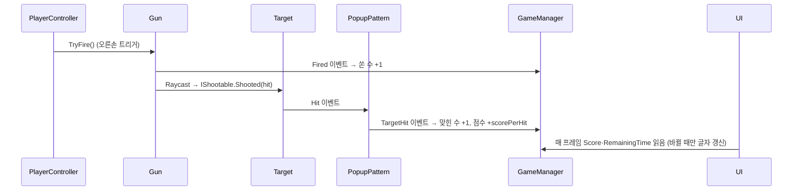
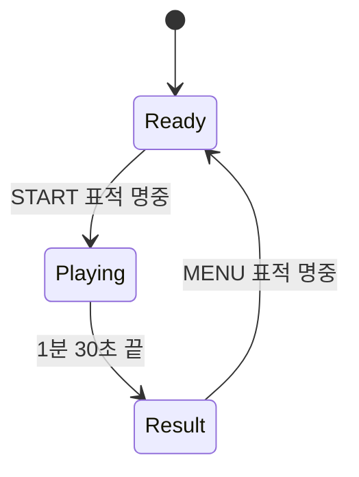

# Quick Draw 개발 설계서

Nov 17, 2026 · 기준 문서: [Concept_Doc.md](Concept_Doc.md)

## 0. 요약

- **환경**: Unity 6000.3.15f1 · URP · XR Interaction Toolkit 3.5.1 (Starter Assets의 XR Origin) · OpenXR
- **작업 범위**: 모든 파일은 `Assets/QuickDraw` 안에 둡니다. 프로젝트 설정(레이어)만 예외입니다.
- **코드 작성 원칙**: 코드는 `/karpathy-skill:karpathy-skill` 스킬을 참조해서 간결하게 수정합니다. 가정은 먼저 밝히고, 필요한 만큼만 쓰고, 요청한 부분만 고치고, 확인 방법을 정한 뒤 끝냅니다.
- **설계 원칙**: 코드는 최대한 간결하게 씁니다. 수치는 그 값을 쓰는 스크립트의 Inspector 필드(`[SerializeField]` + 기본값)로 두고, 데이터 파일이나 데이터 전용 클래스는 만들지 않습니다. 입력 바인딩은 코드에서 `AddBinding`으로 겁니다.
- **손 역할**: 총은 항상 오른손, 탄창은 항상 왼손으로 잡습니다.
- **상호작용**: 잡기는 XRI(Near-Far Interactor 근접)가, 발사와 탄창 빼기 입력은 `PlayerController`가 맡아 `Gun`에 전달합니다. 쥔 탄창을 빈 총 아래에 대면 끼워질 자리에 반투명 가이드가 보이고, 손을 놓으면 끼워져 바로 쏠 수 있습니다. A 버튼은 탄을 다 쓴 탄창만 뺍니다 (3.5).
- **진행 상황**: M0~M5(기반, 총, 탄창, 표적, 게임 흐름, 단계 난이도) 완료. 한 판은 쉬는 시간 없는 90초입니다. 표적은 1단계 팝업 → 2단계 좌우 이동 표적 섞임 → 3단계 일제 등장 추가로 단계마다 패턴이 하나씩 늘어납니다. 자동 테스트는 두지 않고 Play 모드(시뮬레이터)나 헤드셋에서 직접 확인하며, 실제 기기 확인이 남았습니다(7.1). 다음은 M6(다듬기)입니다 (7장).

---

## 1. 수치 (Inspector 기본값)

수치는 아래 스크립트의 Inspector에서 바로 고칩니다. *기울임* 값은 기획서에 없어서 넣은 **제안값**입니다.

| 스크립트 | 필드 | 기본값 |
| --- | --- | --- |
| `GameManager` | `gameDuration` (한 판, 쉬는 시간 없음) | 90초 |
| | `targetRadius` (단계별, 길이 = 단계 수. 게임 시간을 똑같이 나눔 → 30초씩) | 0.5 / 0.35 / 0.25 m |
| | `targetCount` / `targetLifetime` (단계별 동시에 서 있는 수 / 서 있는 시간) | *3 / 4 / 5개* · *1.5 / 1.2 / 1초* |
| | `movingChance` (단계별, 좌우로 움직이는 표적의 비율) | *0 / 0.4 / 0.4* |
| | `volleyInterval` (단계별 일제 등장 간격, 0이면 없음) | *0 / 0 / 8초* |
| | `scorePerHit` | 10 |
| `Gun` | `effectRange` | 30 m (가장 먼 표적 15m보다 길게) |
| | `magazineCapacity` (탄창 1개 탄 수) | 10발 |
| | `hapticAmplitude` / `hapticDuration` | *0.7* / *0.08초* |
| | `triggerPullAngle` | *15°* |
| `LaserSight` | `width` (색은 `M_Laser` 머티리얼, 빨강) | *0.003m* |
| | `dotScale` (거리 1m당 조준점 지름) | *0.005* (15m에서 7.5cm) |
| `ReturnToSpawn` | `returnDelay` | 2초 |
| `Magazine` | `droppedLifetime` (다 쓴 탄창을 뺀 뒤 사라지기까지) | 5초 |
| | `insertDistance` (끼울 자리에서 이만큼 안이면 가이드, 놓으면 끼움) | *0.1m* |
| `MagazineSpawner` | `respawnDelay` (자리가 빈 뒤 새 탄창이 놓이기까지) | *0.3초* |
| | `leaveDistance` (놓은 탄창이 자리에서 수평으로 이만큼 넘게 벗어나면 빈 자리) | *0.05m* |
| | `slots` (탄창 자리, 자식 Transform) | *3개: (-0.29, 1.01, 0.55)에서 -X로 10cm 간격, 눕힌 방향. 테이블 윗면보다 약 12cm 위라 떨어져 놓임* |
| `Target` | `riseTime` (일어나기·쓰러지기 시간) | *0.2초* |
| | `moveWidth` / `moveSpeed` (이동 표적이 왕복하는 폭 / 속도) | *2m (자리 양옆 1m씩)* / *1.5m/s* |
| `PopupPattern` | `slots` (7개 자리, 원판 중심의 월드 좌표) | *(-3, 1.2, 6) (0, 1.5, 5) (3, 1.2, 6) (-4.5, 1.8, 10) (1.5, 2, 9) (-1.5, 1.4, 13) (4, 1.6, 14)* |
| | `volleyCount` / `volleyLifetime` (일제 등장 때 한꺼번에 세우는 수 / 서 있는 시간) | *4개* / *2.5초* |
| | 등장 간격 (필드 아님) | `targetLifetime ÷ targetCount` = 0.5 / 0.3 / 0.2초 |

- 좌표는 월드 좌표입니다. XR Origin이 (0, 0, 0)에서 +Z를 보므로 z가 곧 정면 거리입니다 (5~15m).
- 기획서 값은 한 판 1분 30초(쉬는 시간 없음, 30초마다 단계), +10점, 탄창 10발, 놓친 총 복귀 2초, 표적 거리 5~15m입니다.

### 1.1 입력 바인딩

입력 에셋(`.inputactions`)은 만들지 않고, `PlayerController.OnEnable()`에서 `new InputAction(...)` + `AddBinding(...)`으로 XR 바인딩과 PC 테스트 바인딩을 함께 겁니다. 잡기(그립)는 XRI 기본 입력이 이미 처리하므로 따로 만들지 않습니다.

| 액션 | 용도 | XR 바인딩 | PC 테스트 바인딩 |
| --- | --- | --- | --- |
| `ShootAction` | 발사. UI 버튼(START / MENU)도 쏴서 누름 | `<XRController>{RightHand}/{TriggerButton}` | `<Mouse>/leftButton` |
| `MagOutAction` | 탄창 제거 | `<XRController>{RightHand}/{PrimaryButton}` (A) | `<Keyboard>/r` |

---

## 2. 시스템 (MonoBehaviour)

한 판 동안 바뀌는 값은 그 값을 쓰는 스크립트가 직접 들고 있습니다. 다른 스크립트는 이벤트를 받아 읽기만 합니다.

| 스크립트 | 하는 일 | 가진 값 |
| --- | --- | --- |
| `GameManager` | 단계 전환(`StartGame()`·`ReturnToMenu()`), 게임 시간, 30초마다 표적 수치 단계, 점수·명중률 집계, `PopupPattern` 시작·종료, 메뉴로 돌아갈 때 총 비우기. `PhaseChanged` 이벤트 | `Phase`(`GamePhase`: Ready·Playing·Result), `RemainingTime`, `Score`, `ShotCount`, `HitCount`, `Accuracy` |
| `PlayerController` | 입력. 오른손 트리거 → 든 총의 `TryFire()`, 오른손 A → `TryEjectMagazine()` | 없음 (든 총은 오른손 `NearFarInteractor`에서 바로 읽음) |
| `PlayerMoveLock` | PC 테스트용 XR 시뮬레이터에서 제자리를 지킴: FPS 모드의 WASD 이동과 Point-and-Click을 끔 (헤드셋 이동은 씬 설정으로 이미 막혀 있음) | 시뮬레이터 원래 이동 배율, Point-and-Click 사용 여부 |
| `Gun` | `TryFire()`·`TryEjectMagazine()`(A, 0발일 때만)·`EjectMagazine()`(메뉴 복귀, 항상)·`InsertMagazine()`, 매 프레임 조준 레이캐스트(`AimTarget`, 쏠 때는 다시 겨눠 판정), 연출 | `Ammo`, `HasMagazine` |
| `LaserSight` | 잡혀 있을 때 총구에서 조준선과 점 표시 | 없음 |
| `UI_Gun` | 총 뒤쪽 남은 탄 숫자 (`Gun.AmmoChanged` 구독) | 없음 |
| `ReturnToSpawn` | 손에서 놓친 뒤 2초 안에 다시 잡히지 않으면 처음 놓여 있던 자리(테이블)로 복귀, 다시 잡으면 취소 | 시작 위치·회전, 복귀 코루틴 |
| `SnapGuide` | 손이 가까이 오면 잡힐 자리에 반투명 미리보기 표시 (3.2) | 미리보기 오브젝트 |
| `Magazine` | 손에 든 채 빈 총의 끼울 자리 근처면 그 자리에 반투명 가이드, 거기서 놓으면 `Gun.InsertMagazine(this)` → `AttachTo(socket)`로 총의 자식이 됨. 빼면 `Drop()`으로 떨어지고 다시 못 잡으며 `droppedLifetime` 뒤 제거. 씬의 Gun은 모든 탄창이 한 번 찾아 같이 씀 | 끼울 자리 가이드, 끼우기 요청 |
| `MagazineSpawner` | 시작할 때 자리마다 탄창을 놓고, 그 탄창이 집혀 가거나 밀려나거나 사라지면 `respawnDelay` 뒤 그 자리에 새 탄창 (3.5) | 자리마다 놓은 탄창, 자리가 빈 채로 지난 시간 |
| `IShootable` | 총에 맞을 수 있는 물체의 인터페이스: `Shooted(RaycastHit hit)` (총의 조준 레이캐스트가 맞은 지점) | |
| `Target` | `Show(원판 중심, 반지름, 이동 여부)`(일어남, 이동이면 서 있는 동안 좌우 왕복)·`Hide()`(바로 사라짐)·`Fall()`(쓰러진 뒤 사라짐), 원형 명중 판정, `Hit` 이벤트 | `IsStanding` |
| `PopupPattern` | 게임의 모든 표적. 정해진 자리에 나타났다 쓰러짐, 일부는 좌우 이동, 간격마다 일제 등장. `Begin(radius, count, lifetime, movingChance, volleyInterval)`, `End()`, `TargetHit` 이벤트. `Target.prefab`은 필요할 때 만들어 돌려 씀 | 표적마다 자리·쓰러질 시각 |
| `UI` | World Space UI. `PhaseChanged`를 받아 Menu / Score / Result 중 하나만 보임. Score는 남은 시간(`m:ss`)과 점수만(바뀔 때만 글자 갱신), Result는 점수·명중률과 MENU 버튼만 표시. `UI` 루트가 `IShootable`이고, 맞은 콜라이더가 START면 `StartGame()`, MENU면 `ReturnToMenu()`, 튜토리얼 보드면 이스터에그 적중 수를 셈. Ready에서는 튜토리얼 보드도 보임 | 튜토리얼 적중 수 |

정한 규칙:

- 쏜 수와 맞힌 수는 **Playing 단계에서만** 셉니다. Ready, Result에서 쏜 탄(START, MENU 포함)은 명중률에 들어가지 않습니다.
- 명중률 = 맞힌 수 ÷ 쏜 수 (0발이면 0).
- 매 판은 빈 총(탄창 없음)으로 시작합니다. MENU로 메뉴에 돌아가면 꽂힌 탄창을 빼고 남은 탄을 버립니다.
- 탄창을 끼우면 바로 쏠 수 있습니다 (`Ammo = 10`).
- 탄창이 없거나 탄이 0발일 때 방아쇠를 당기면 딸깍 소리만 나고 쏜 수에 들어가지 않습니다.
- A 버튼(`TryEjectMagazine`)은 탄이 0발일 때만 탄창을 뺍니다. 탄이 남아 있으면 아무 일 없습니다(로그만).
- 메뉴 복귀(`EjectMagazine`)는 탄이 남아 있어도 빼고, 남은 탄은 버립니다 (`Ammo = 0`).
- 쓰러져 있는 표적은 맞혀도 점수가 없습니다.

### 2.1 시스템끼리 연결

`Gun`은 **`Fired`를 레이캐스트 처리보다 먼저** 보냅니다. 순서가 바뀌면 START를 쏜 탄이 Playing이 된 뒤에 집계되어 게임의 쏜 수에 들어갑니다.



### 2.2 게임 단계



| 바뀐 단계 | `GameManager`가 하는 일 |
| --- | --- |
| → Playing | 점수·쏜 수·맞힌 수를 0으로, 남은 시간 = `gameDuration`(90초). 바로 1단계 수치로 `popup.Begin` |
| Playing 중 | 지난 시간 ÷ (`gameDuration` ÷ 단계 수)로 단계를 정해, 바뀔 때만 `popup.Begin(targetRadius[단계], targetCount[단계], targetLifetime[단계], movingChance[단계], volleyInterval[단계])`. `End`는 부르지 않아 서 있던 표적은 그대로 |
| Playing → | `popup.End()`. 남은 표적이 한꺼번에 쓰러짐 |
| → Ready | Menu 보드와 START 표적 보이기. `gun.EjectMagazine()`으로 빈 총으로 만듦 (탄창이 없으면 아무 일 없음) |
| → Result | Result 보드에 점수·명중률과 MENU 표적 보이기 |

### 2.3 표적 패턴 동작

- **크기와 명중**: `Target` 크기는 반지름 × 2로 맞추고, 표적 면이 플레이어(원점) 쪽을 보도록 돌립니다. 콜라이더가 원판 모양이라, 콜라이더에 맞으면 명중입니다.
- **Target.prefab 구조**: 쓰러지는 회전축이 바닥이어야 하므로 루트 피벗은 원판 아래 끝에 두고, 원판은 자식 `Face`로 둡니다. 겉모습은 흰-빨-흰-빨 과녁에 얇은 검은 테두리입니다.
  - `Face`: 실린더를 지름 1m·두께 2cm로 눌러 +Z(플레이어 쪽)를 보게 눕힘, `M_Target`(흰색), 실린더 메시 그대로의 Convex MeshCollider(원판 모양) = 명중 범위.
  - 과녁 무늬: `Face` 아래로 원판을 자식으로 겹칩니다. `Center`(빨강 `M_TargetCenter`) → `Face (1)`(흰 `M_Target`) → `Center (1)`(빨강)이고, 지름은 1.0 / 0.75 / 0.5 / 0.25입니다. 자식 스케일은 부모에 곱해지므로 부모 대비 비율(0.75, 0.667, 0.5)로 넣고, 두께는 1.2배씩 키워 작은 원판이 조금씩 앞으로 나와 보이게 합니다. Unity 기본 실린더의 윗면 UV는 원 모양으로 펴져 있지 않아 텍스처 대신 원판을 겹칩니다.
  - `Border`: `Face`의 자식, 지름 1.04·두께 절반, `M_TargetBorder`(거의 검정). 흰 원 뒤에 깔려 바깥 2%만 보입니다.
  - 무늬 원판과 `Border`에는 콜라이더가 없어, 테두리는 맞아도 빗나감입니다. `M_TargetCenter`는 START / MENU 버튼과 같이 쓰므로 색을 바꾸지 않습니다.
  - `Show`가 루트를 반지름 × 2로 키워서 층 사이 간격도 같이 줄지만, 3단계(지름 0.5m) 표적을 15m에서 찍어도 층이 깜빡이지 않습니다 (Play 모드 확인, 에디터 D3D12. Quest의 Vulkan도 같은 reversed-Z 깊이를 씀).
  - 모든 부품이 Physics Layer `Shootable`.
- **타격 효과**: 맞으면 `Target.hitEffect`(`HitEffect.prefab`)를 맞은 지점에 `hit.normal`(플레이어 쪽) 방향으로 만들고 표적은 바로 사라집니다. 루트는 주황 섬광 1개(지름 1m, 0.12초), 자식 `Sparks`는 노랑~빨강 불꽃 30개가 50° 원뿔로 2~5m/s 튀어 중력에 떨어지며 0.3~0.45초 뒤 사라집니다(속도 방향으로 늘린 모양). 다 끝나면 `stopAction = Destroy`로 오브젝트째 지워집니다. 재료는 총구 화염과 같은 `M_Fx`입니다.
- **연출**: `Show`는 루트를 축으로 누운 자세(−90°)에서 `riseTime` 동안 일어나고, `Fall`은 플레이어 반대쪽으로 `riseTime` 동안 누운 뒤 꺼집니다. `Show` 순간부터 맞힐 수 있고, `Fall`이 시작되면 맞혀도 무시합니다. 맞으면 `Hide`로 바로 꺼집니다.
- **단계마다 패턴이 하나씩 늘어남**: 게임 내내 `PopupPattern` 하나로 돌고, 30초마다 단계가 오르면 `GameManager`가 넘기는 값이 바뀝니다: 반지름 0.5 → 0.35 → 0.25m, 동시에 서 있는 수 3 → 4 → 5, 서 있는 시간 1.5 → 1.2 → 1초, 이동 표적 비율 0 → 0.4 → 0.4, 일제 등장 간격 없음 → 없음 → 8초.
  - 1단계: 팝업만 (제자리에서 일어났다 쓰러짐).
  - 2단계: 새로 나오는 표적의 40%가 **좌우 이동 표적**입니다.
  - 3단계: 이동 표적에 **일제 등장**이 더해집니다.
- **좌우 이동 표적 (`Target`)**: `Show(..., moving: true)`로 세우면 서 있는 동안 자리를 가운데로 표적 면의 옆 방향(`facing * right`)으로 `moveWidth`(2m) 폭을 `moveSpeed`(1.5m/s)로 왕복합니다(`Mathf.PingPong`, 가운데에서 출발). 쓰러지기 시작하면 그 자리에 멈춥니다. 콜라이더가 같이 움직이므로 명중 판정은 그대로입니다.
- **일제 등장 (`PopupPattern`)**: `volleyInterval`이 0보다 크면, 그 시간이 지날 때마다 새 표적을 멈추고 서 있던 표적이 모두 쓰러지거나 맞아 사라질 때까지 기다린 뒤(`WaitUntil`, 화면이 비는 게 신호) `volleyCount`(4)개를 한꺼번에 세웁니다. 이 표적은 `volleyLifetime`(2.5초) 동안 서 있고(이동 비율도 똑같이 적용), 그 시간이 지나면 평소 흐름으로 돌아가며 다음 간격을 셉니다. 그래서 일제 등장은 약 11~12초마다 한 번(간격 8초 + 비우기 약 1초 + 2.5초) 나옵니다 (Play 모드 확인: 화면이 빈 직후 4개가 함께 서고 2.5초 뒤 쓰러짐).
- **등장**: `lifetime ÷ count` 간격마다 서 있는 수를 세어 `count`보다 적으면 하나를 내보냅니다. 그러면 안 맞혀도 `count`개쯤이 엇갈려 서 있습니다. 간격을 고정(예: 0.6초)하면 서 있는 시간이 짧은 단계일수록 동시에 서 있는 수가 오히려 줄어서(1.0초 ÷ 0.6초 ≈ 1.7개) 이렇게 정했습니다.
- **자리**: `slots`(원판 중심 좌표) 가운데 **비어 있고(서 있거나 쓰러지는 표적이 없음), 방금 표적이 사라진 자리가 아닌** 곳에 나타납니다. `lifetime`이 지나면 쓰러지고, 맞으면 바로 사라집니다. 두 표적이 같은 자리를 고르지 않도록 자리는 고르는 순간 예약합니다. 3단계는 5개 + 쓰러지는 중 1개 + 방금 비운 자리 1개로 7자리를 거의 다 쓰므로, 빈자리가 없으면 그 차례는 건너뜁니다.
- **표적 오브젝트**: 꺼진 표적을 다시 쓰고, 모두 쓰고 있으면 `Target.prefab`을 하나 더 만듭니다. 쓰러지는 중인 표적은 꺼질 때까지 다시 쓰지 않습니다. 3단계까지 해도 6개면 충분합니다(Play 모드 확인). 단계가 바뀌는 순간에는 앞 단계 표적과 새 단계 표적이 잠깐 섞여 서 있습니다.

---

## 3. 상호작용 설계

### 3.1 XR Origin과 손

- 씬에 이미 있는 Starter Assets의 `XR Origin (XR Rig)`를 씁니다.
- 제자리 게임이므로 `Locomotion`(이동, 회전, 텔레포트)과 양손의 `Teleport Interactor`를 끄고, Floor의 `TeleportationArea`를 지웁니다. 헤드셋에서 움직이지 않는 것은 이 씬 설정만으로 됩니다 (`PlayerMoveLock`은 PC 시뮬레이터만 맡음).
- **잡기는 각 손의 Near-Far Interactor**로 하고, 원거리(Far) 잡기는 끄고 근접만 남깁니다. 손에서 나가는 레이가 총 레이저와 겹치지 않습니다.
- **Poke Interactor는 끕니다.** XRI의 `XRPokeInteractor`는 그립 같은 선택 입력 없이 닿기만 하면 선택해서, "가져다 대고 그립으로 스냅"하는 방식에 맞지 않습니다. UI도 사격으로 누릅니다.
- **손 고정**: 오른손 Near-Far Interactor는 `Gun` Interaction Layer만, 왼손은 `Magazine`만 잡습니다. 코드 없이 "총은 오른손, 탄창은 왼손"이 지켜지고, 반대 손을 대면 가이드도 뜨지 않습니다.

### 3.2 스냅 가이드라인

"가져다 대면 스냅 가이드라인이 먼저 보인 후, 대응되는 입력을 하면 스냅된다"를 세 경우로 나눠 만듭니다.

| 대상 | 가져다 대면 (가이드) | 대응 입력 (스냅) |
| --- | --- | --- |
| 총 → 오른손 | `SnapGuide`: 손에 잡혔을 때의 위치에 반투명 총이 보임 | 오른손 그립 → `GunAttach` 기준으로 손에 붙음 |
| 탄창 → 왼손 | `SnapGuide`: 반투명 탄창이 보임 | 왼손 그립 → 손에 붙음 |
| 탄창 → 총 | 쥔 탄창을 빈 총 아래(`MagazineSocket` 0.1m 안)에 대면 끼워질 자리에 반투명 탄창 (`Magazine`) | 손 놓기 → 끼워짐 (3.5) |

- `SnapGuide`는 매 프레임 `isHovered && !isSelected`일 때만 미리보기를 보여줍니다. 이벤트 순서를 신경 쓰지 않아도 hover 시작·끝과 잡기가 모두 처리됩니다.
- 미리보기는 같은 메시에 반투명 머티리얼(`M_SnapGuide`)을 씌운 복제본입니다. `Awake`에서 물체와 자식의 `MeshFilter`를 복제해 만듭니다.
- 미리보기는 hover한 손의 Attach Transform 아래에 붙습니다. 위치는 "물체 기준 Attach(`GunAttach`) 자세의 역"이므로, 그립하면 실제로 붙을 자리와 같고 손을 그대로 따라갑니다.

### 3.3 총 (`Gun`)

| 항목 | 설정 |
| --- | --- |
| 총열 방향 | Gun_9mm 모델은 총열이 **로컬 +X**입니다. 레이캐스트, 레이저, 기즈모 모두 `transform.right`를 씁니다 |
| 총구 위치 | `muzzleOffset`(총 기준 로컬 좌표) → `MuzzleWorldPos`. 총구 화염 ParticleSystem도 같은 위치에 둡니다 |
| 잡기 | `XRGrabInteractable`, Interaction Layer = `Gun`, Movement Type = **Instantaneous**. Velocity Tracking은 각속도로 회전을 따라가서 손목을 빨리 돌리면 늦게 따라오다 튀고, 콜라이더에 밀립니다. Instantaneous는 잡는 동안 Rigidbody를 kinematic으로 두고 손 위치·회전을 그대로 씁니다 |
| 잡는 위치 | Use Dynamic Attach는 끄고, 손잡이에 만든 `GunAttach`를 Attach Transform으로 지정합니다. XRI는 Attach의 +Z를 손이 가리키는 방향으로 맞추므로 `GunAttach`는 +Z가 총열(+X)을 향하도록 Y축으로 90° 돌립니다. 지금 `GunAttach`는 총의 로컬 원점(모델 피벗)에 있으므로, M1에서 쥐었을 때 손잡이가 손바닥에 오는지 보고 위치를 맞춥니다 |
| 콜라이더 | Colliders 목록은 비워 둡니다. XRI가 총의 콜라이더(몸체, `Gate_07`)를 트리거만 빼고 모두 모아 잡기에 씁니다. non-convex MeshCollider는 Rigidbody와 같이 쓸 수 없으므로 Convex를 켜거나 BoxCollider로 바꿈 |
| 발사 | `PlayerController`가 `TryFire()`를 부릅니다. `Gun`은 XRI의 `activated` 이벤트를 듣지 않습니다. 둘 다 들으면 트리거 한 번에 두 발이 나갑니다 |
| 조준 | 총을 쥐고 있을 때만 매 프레임 레이캐스트로 맞은 콜라이더의 오브젝트(`hit.collider`)를 `AimTarget`에 담습니다 (내려놓으면 `AimTarget` = 없음). 같은 레이캐스트로 맞은 거리를 `AimDistance`(맞은 게 없으면 사거리)에 담습니다. `hit.transform`은 Rigidbody가 있으면 그 오브젝트를 돌려주므로 쓰지 않습니다. 트리거 콜라이더는 무시합니다(`QueryTriggerInteraction.Ignore`). 로그는 대상이 바뀔 때만 남깁니다. `LaserSight`가 이 값을 씁니다 |
| 명중 대상 찾기 | 쏠 때 `Update`의 조준과 같은 `Aim()`으로 다시 레이캐스트해서, 맞은 콜라이더의 `GetComponentInParent<IShootable>()`에 그 `RaycastHit`를 `Shooted(hit)`로 넘깁니다. `AimTarget`은 `Update`에서 정하므로, `PlayerController.Update`가 `Gun.Update`보다 먼저 돌면 한 프레임 전 조준이 남아 있기 때문입니다. 콜라이더가 자식(`Face`)에 있고 `Target`이 루트에 있어도 맞습니다 |
| 레이캐스트 마스크 | `hitMask` = Default + Shootable (총, 탄창, 손, UI 보드 제외) |
| 진동 | `TryFire()`가 성공하면 총을 잡은 Interactor의 부모에서 `HapticImpulsePlayer`(XR Origin의 컨트롤러 오브젝트에 있음)를 찾아 `SendHapticImpulse(hapticAmplitude, hapticDuration)`. XRI 3.5.1의 Interactor에는 `SendHapticImpulse`가 없습니다 |
| 소리 | 모두 `AudioSource.PlayClipAtPoint(클립, 총구)`로 재생합니다. AudioSource 컴포넌트는 필요 없고, 칸이 비어 있으면 소리 없이 넘어갑니다. `TryFire()` 성공 → `gunfireClip`(`Audio/Gunfire.mp3`), 탄이 없을 때 → `dryFireClip`(`Audio/DryFire.wav`, "틱"), `InsertMagazine()` → `magazineInClip`(`Audio/MagIn.wav`, "철컥"), `EjectMagazine()` → `magazineOutClip`(`Audio/MagOut.wav`, 미끄러져 빠지는 소리). 클립은 `Gun.prefab`에 연결합니다 |
| 효과음 만들기 | `Audio/`의 WAV 3개는 `SoldierSoundsPack/reload.mp3`(3초 재장전 소리)에서 잘라 만들었습니다. 파형을 분석해 고른 구간: DryFire 0.612~0.665초(어택 2ms·25ms의 짧은 틱), MagIn 0.675~0.80초(가장 크고 높은 쇳소리, 60ms 간격 두 번 타격), MagOut 1.82~2.10초(167ms 동안 커지는 미끄러짐 끝에 걸림 소리). 앞 5ms·뒤 30ms를 페이드하고 피크를 0.8로 맞춘 16bit WAV입니다. 귀로 확인하지 않고 파형으로 고른 것이라, 직접 들어 보고 다르면 구간을 바꿔 다시 자릅니다 |
| 레이저 | `LaserSight`가 잡혀 있을 때만 총구에서 `AimDistance`까지 LineRenderer로 선을 긋고, 맞은 게 있으면 끝에 구 모양 점을 둡니다. 선과 점은 총 **로컬 좌표**로 그려서, XRI가 렌더링 직전(OnBeforeRender)에 총을 옮겨도 어긋나지 않습니다. 점은 `Start`에서 만들어 `SnapGuide` 미리보기에 섞이지 않게 합니다 |
| 총구 화염 | `Gun.prefab`의 자식 `MuzzleFlash`(ParticleSystem, 총구 위치, +Z = 총열 방향, 로컬 시뮬레이션)를 `muzzleFlash`에 연결하고, `TryFire()`가 성공하면 `Play()`. 노랑~주황 원형 4개가 0.05~0.07초 동안 터지며 작아집니다(크기 0.1~0.18m). 빈 총 딸깍에는 없습니다 |
| 이펙트 재료 | `T_FxSoft.png`(64px 흰 원, 가장자리로 갈수록 투명, 스크립트로 만듦) + `M_Fx`(URP `Particles/Unlit`, 투명·알파 블렌드). POLY 번들의 파티클 텍스처는 알파가 없어 가산으로만 쓸 수 있는데, 가산은 밝은 하늘과 흰 표적 위에서 묻혀서 쓰지 않았습니다(그 머티리얼은 옛 내장 셰이더라 URP에서 분홍색) |
| 방아쇠 | 쏠 때 `trigger` 부품(모델의 `Trigger_Guard_07`)을 `triggerPullAngle`만큼 돌렸다 되돌림 (선택) |
| 놓쳤을 때 | `ReturnToSpawn`: `Awake` 때 위치·회전을 기억해 두고, 놓친 뒤 2초 안에 다시 잡지 않으면 속도를 0으로 하고 그 자리로 옮깁니다. 따로 스폰 지점 오브젝트를 두지 않습니다 |

완성 때의 모양입니다. `trigger`(M6)는 아직 없습니다.

```csharp
public class Gun : MonoBehaviour
{
    [Header("총 규격")]
    [SerializeField] private float effectRange = 30f;           // 총 최대 사거리
    [SerializeField] private int magazineCapacity = 10;         // 탄창 1개 탄 수

    [Header("레이 캐스트")]
    [SerializeField] private Vector3 muzzleOffset;              // 총구 위치 (총 기준 로컬 좌표)
    [SerializeField] private LayerMask hitMask;                 // Default + Shootable만 체크

    [Header("총기 부품")]
    [SerializeField] private Transform trigger;
    [SerializeField] private Transform magazineSocket;          // 끼운 탄창이 붙는 자리 (총 원점)

    [Header("발사 효과")]
    [SerializeField] private ParticleSystem muzzleFlash;
    [SerializeField] private AudioClip gunfireClip;
    [SerializeField] private AudioClip dryFireClip;                // 탄이 없을 때 딸깍
    [SerializeField] private AudioClip magazineInClip;             // 탄창을 끼울 때
    [SerializeField] private AudioClip magazineOutClip;            // 탄창이 빠질 때
    [SerializeField] private float hapticAmplitude = 0.7f;
    [SerializeField] private float hapticDuration = 0.08f;

    public int Ammo { get; private set; }
    public bool HasMagazine { get; private set; }
    public GameObject AimTarget { get; private set; }           // 총구가 겨누는 콜라이더의 오브젝트 (표적 / UI 포함)
    public float AimDistance { get; private set; }              // 겨눈 지점까지 거리 (LaserSight가 씀)
    public Vector3 MuzzleOffset => muzzleOffset;
    public event Action Fired;                                  // 실제로 탄이 나갔을 때
    public event Action<int> AmmoChanged;

    public bool TryFire();                                      // PlayerController가 호출
    public void TryEjectMagazine();                             // PlayerController(A)가 호출. 0발일 때만 뺌
    public void EjectMagazine();                                // GameManager(메뉴 복귀)가 호출. 남은 탄을 버리고 뺌
    public Transform MagazineSocket => magazineSocket;
    public void InsertMagazine(Magazine magazine);              // 끼울 자리 근처에서 탄창을 놓았을 때 Magazine이 호출
}
```

### 3.4 입력 (`PlayerController`)

`PlayerController`는 "플레이어 입력을 받아 손에 든 총에 전달하는" 역할입니다. 호출은 `PlayerController` → `Gun` 한 방향이고, `Gun`은 `PlayerController`를 모릅니다.

```csharp
public class PlayerController : MonoBehaviour
{
    private InputAction ShootAction;    // 오른손 트리거 (마우스 좌클릭) : 발사 / UI 선택
    private InputAction MagOutAction;   // 오른손 A (키보드 R)          : 탄창 제거

    [SerializeField] private NearFarInteractor RightHand;   // 총 고정임

    private void Update()
    {
        // 오른손에 총을 들고 있을 때만 입력을 총에 전달한다
        if (!RightHand.hasSelection) return;
        if (!RightHand.firstInteractableSelected.transform.TryGetComponent(out Gun heldGun)) return;

        if (ShootAction.WasPressedThisFrame()) heldGun.TryFire();
        if (MagOutAction.WasPressedThisFrame()) heldGun.TryEjectMagazine();   // 탄을 다 쓴 탄창만 빠진다
    }
}
```

### 3.5 탄창 끼우기와 배출

순서: 왼손으로 탄창을 쥐고 빈 총 아래에 댐 → 끼워질 자리에 반투명 탄창 가이드가 보임 → 손을 놓음 → 자동으로 끼워져 바로 쏠 수 있음.

- **모델 기준**: `Magazine_9mm` 메시는 `Gun_9mm`과 같은 좌표계로 만들어져 있어, 탄창을 총 원점에 같은 회전으로 두면 손잡이에 끝까지 끼운 모습이 됩니다.
- **끼울 자리**: 총의 자식 `MagazineSocket`(빈 Transform, 총 원점, 회전 없음). XRI 소켓(`XRSocketInteractor`)은 쓰지 않습니다.
- **가이드**: 탄창이 손에 들려 있고, 총에 탄창이 없고, 탄창 원점이 소켓에서 `insertDistance`(0.1m) 안이면 소켓에 붙인 반투명 탄창을 보여줍니다. 가이드는 `SnapGuide.CreatePreview()`로 `Start`에서 하나 만들어 둡니다(손에 잡히기 전 가이드와 같은 머티리얼). 탄창이 사라지면 가이드도 지웁니다.
- **놓으면 끼움**: 놓일 때(`selectExited`, 다른 Interactor가 잡고 있지 않을 때) 같은 조건(빈 총, `insertDistance` 안)이면 다음 `Update`에서 `Gun.InsertMagazine(this)`를 부릅니다 (XRI가 놓기 처리를 끝낸 뒤). 탄창은 XRI 기본 Grab Transformer로 손을 따라갑니다.
- **끼우기 (`Gun.InsertMagazine` → `Magazine.AttachTo(socket)`)**: 탄창의 `XRGrabInteractable`을 끄고(꽂힌 탄창은 손으로 못 뺌), Rigidbody를 kinematic으로 하고, `MagazineSocket`의 자식으로 원점·회전 없이 붙입니다. 총을 따라 그대로 움직입니다. `Gun`은 꽂힌 탄창을 들고 있어 `HasMagazine = magazine != null`, `Ammo = magazineCapacity`(10발).
- **다른 곳에서 놓으면**: 탄창은 중력으로 떨어져 바닥에 남고, 다시 주울 수 있습니다.
- **배출**: 오른손 A → `heldGun.TryEjectMagazine()` → 0발일 때만 `EjectMagazine()` → `magazine.Drop()` → `Ammo = 0`. 탄이 남아 있으면 빠지지 않습니다. 메뉴 복귀 때는 `GameManager`가 `EjectMagazine()`을 바로 불러 남은 탄과 함께 뺍니다.
- **다 쓴 탄창 (`Magazine.Drop`)**: 총에서 떼어(부모 없음) Rigidbody를 다시 움직이게 하고 `Destroy(gameObject, droppedLifetime)`을 겁니다. 잡기는 끼울 때 꺼진 그대로라 다시 잡거나 꽂을 수 없고(빼고 다시 꽂아 10발 채우기 방지), 5초 뒤 사라집니다. 다 쓰지 않은 탄창은 지우지 않습니다 (9장 4).
- **탄창 보충**: `MagazineSpawner`(`Prop/MagazineSpawner`, 자식 `Slot1~3`)가 시작할 때 자리마다 `Magazine.prefab`을 놓고, 자리마다 놓은 탄창을 기억합니다. 매 프레임 그 탄창이 집혀 있거나(`isSelected`), 사라졌거나(총에 끼워 뺀 뒤 지워짐 등), 자리에서 수평으로 `leaveDistance`(5cm) 넘게 벗어났으면(손이나 제자리로 돌아오는 총에 밀림) 빈 자리로 보고, `respawnDelay` 동안 빈 채면 그 자리에 새 탄창을 놓습니다. 자리는 테이블 윗면보다 약 12cm 위라 탄창이 떨어져 놓이므로, 높이는 빼고 수평 거리만 봅니다. 밀린 탄창은 그대로 남고, 새 탄창이 그 위로 떨어져도 튕기지 않습니다 (Play 모드 확인). 씬에 직접 놓는 탄창은 없습니다.
- **탄창 물리**: 탄창은 2cm로 얇아서 떨어질 때 바닥을 뚫지 않게 Rigidbody Collision Detection을 Continuous Dynamic으로 둡니다.
- **시작**: 매 판 빈 총(탄창 없음)으로 시작합니다. 처음에는 `MagazineSocket`이 비어 있고, MENU로 메뉴에 돌아갈 때는 `GameManager`가 `gun.EjectMagazine()`을 부릅니다. 테이블의 탄창을 끼운 뒤 START를 쏩니다.
- 탄창 Movement Type도 Instantaneous로 해서 손을 따라갈 때 흔들리지 않게 합니다.

### 3.6 레이어

| 종류 | 번호 | 이름 | 붙는 곳 | 잡을 수 있는 쪽 |
| --- | --- | --- | --- | --- |
| Interaction Layer | 3 | `Gun` | 총 | 오른손 |
| Interaction Layer | 4 | `Magazine` | 테이블 탄창, 손에 든 탄창 | 왼손 |

| 종류 | 번호 | 이름 | 용도 |
| --- | --- | --- | --- |
| Physics Layer | 8 | `Gun` | 총과 자식 (`MagazineSocket`은 콜라이더 없음) |
| Physics Layer | 9 | `Magazine` | 탄창. `Gun`과 충돌 끔 (`ProjectSettings/DynamicsManager.asset`의 레이어 충돌표, M2-b) |
| Physics Layer | 10 | `Shootable` | 표적(M3), START / MENU (M4), 튜토리얼 보드 `Panel` (이스터에그) |

Interactor별 Interaction Layer Mask는 오른손 = `Gun`, 왼손 = `Magazine`입니다.

Near-Far Interactor의 근접 캐스터(`Sphere Interaction Caster`)는 Physics Layer Mask에 든 콜라이더만 찾습니다. 오른손 = Default + `Gun`, 왼손 = Default + `Magazine`입니다 (M2-b에서 XR Origin 씬 오버라이드로 지정). 빠뜨리면 손을 대도 잡히지 않습니다.

**UI 보드**: Menu, Score, Result 보드는 플레이어 앞 4.1m에 있고, 표적은 그 뒤 5~15m에 나옵니다. `UI` 아래 전체를 `Ignore Raycast` 레이어로 두고(`hitMask`에 없음), START / MENU 버튼만 `Shootable`로 둡니다. 보드 뒤판에는 콜라이더가 없습니다. 예외로 메뉴 왼쪽의 튜토리얼 보드(`UI/Tutorial/Panel`)는 이스터에그를 위해 `Shootable` + BoxCollider(두께 2cm)입니다.

**총 이스터에그**: Ready에서 튜토리얼 보드를 `hitsPerSkin`(10)발 맞힐 때마다 `UI`가 `gun.SetSkin(gunSkins[...])`를 불러 총 몸체가 황금(`M_GunGold`) → 은하(`M_GunGalaxy`) → 용암(`M_GunLava`) → 진주광(`M_GunPearl`) → 원래 모습 순서로 바뀌고 계속 돕니다. 적중 수는 `UI`에 남아 판이 바뀌거나 메뉴로 돌아가도 유지되고, 게임(Play)을 끄면 처음부터입니다. `Gun.SetSkin`은 `bodyRenderers`(Gun, Gate_07, Trigger_Guard_07)의 머티리얼만 바꾸고(null이면 `Awake` 때 기억한 원래 것), 레이저·남은 탄 숫자·총구 화염·탄창은 그대로입니다. 튜토리얼 보드는 Ready에서만 보이므로 게임 중에는 맞힐 수 없습니다. 황금은 URP Lit 금속 머티리얼이고, 나머지 셋은 `Shaders/`의 직접 쓴 셰이더입니다: `QuickDraw/Galaxy`(보라·파랑 성운이 흐르고 별이 반짝임), `QuickDraw/Lava`(검은 바위에 주황 균열이 맥동, 보로노이 경계), `QuickDraw/Pearl`(보는 각도에 따라 파스텔 무지갯빛). 공통 코드는 `GunSkin.cginc`에 있습니다: 무늬를 총의 **오브젝트 좌표(m)**로 계산해 총이 움직여도 무늬가 따라가고(모델 UV는 아틀라스라 무늬용으로 쓰지 않음), 씬 조명 대신 고정된 빛 방향으로 명암을 주며, VR 양눈 렌더링(single-pass instanced)용 인스턴싱·스테레오 매크로를 넣었습니다. 무늬 크기·속도는 각 머티리얼 Inspector에서 바꿉니다.

### 3.7 PC 테스트

- 발사(마우스 좌클릭)와 탄창 빼기(R)는 `PlayerController`의 PC 바인딩을 씁니다.
- 잡기는 손 위치가 있어야 동작하므로 **XR Interaction Simulator**로 합니다. XRI 설정에서 Play 할 때 시뮬레이터를 자동으로 만들도록(에디터에서만) 켜져 있어 씬에 따로 넣지 않습니다.
- `PlayerMoveLock`이 시뮬레이터 FPS 모드(헤드셋과 양손이 함께 움직임)일 때만 이동 배율을 0으로 해서 WASD 이동을 막습니다. 마우스 시점 회전과 컨트롤러 개별 조작은 그대로입니다. 이동 배율(`bodyTranslateMultiplier`)은 컨트롤러 하나만 움직일 때도 쓰여서, 시뮬레이터 프리팹 설정으로 0을 박아 두면 손을 총까지 옮길 수 없습니다. 그래서 설정 대신 스크립트로 FPS 모드일 때만 바꿉니다.
- 시뮬레이터는 씬 로드 뒤에 생기므로 `PlayerMoveLock`이 매 프레임 찾습니다. 시뮬레이터는 씬이 바뀌어도 남으므로, `PlayerMoveLock`이 꺼질 때 이동 배율과 Point-and-Click을 원래 값으로 되돌립니다.
- `PlayerMoveLock`이 시뮬레이터의 Point-and-Click을 끕니다. 이 기능은 커서 아래 첫 물리 충돌 지점으로 컨트롤러를 돌리는데, 레이어를 거르지 않아 손에 든 총에도 맞습니다. 그러면 컨트롤러가 한 프레임에 크게 꺾여 총이 튑니다. 총구가 정면을 볼수록 총이 커서 근처에 와서 심해집니다.
- 조작: `]`로 오른쪽 컨트롤러 선택 → 마우스 우클릭을 누른 채 움직여 회전(또는 방향키) → 손을 총에 대고 **G**로 잡기 (누르고 있는 동안만 잡힘) → 좌클릭(또는 T) 발사, R 탄창 빼기.
- 시뮬레이터의 G·T 같은 버튼 키는 `[`/`]` 선택과 상관없이 **오른쪽** 컨트롤러로 갑니다. 왼쪽 컨트롤러로 보내려면 **Shift**를 누른 채 누릅니다.
- 두 손을 함께 쥐려면 퀵 액션으로 그립을 켜 둡니다: 컨트롤러를 고르고 **`**(백쿼트)를 한 번 눌러 퀵 액션을 Grip으로 바꾼 뒤 **Space**로 그립을 켜고 끕니다. 퀵 액션 종류는 컨트롤러마다 따로 기억합니다.
- 탄창 끼우기: `]` → ` → Space로 총을 쥔 채, `[` → ` → Space로 탄창을 잡고, 총 아래로 옮겨 가이드가 보이면 Space로 놓습니다.

---

## 4. 폴더 구조와 코딩 규칙

### 4.1 폴더 구조

```
Assets/QuickDraw/
├─ Concept_Doc.md
├─ Dev_Design.md                 ← 이 문서
├─ Audio/                        Gunfire.mp3 (SoldierSoundsPack/fire.mp3를 옮김), DryFire.wav, MagIn.wav, MagOut.wav
│                                (SoldierSoundsPack/reload.mp3에서 잘라 만듦, M6)
├─ Materials/                    M_Table, M_Target, M_TargetCenter (M3), M_TargetBorder (과녁 테두리, M6), M_Board (M4),
│                                M_SnapGuide, M_Laser (M1), M_Fx (M6), M_GunGold, M_GunGalaxy, M_GunLava, M_GunPearl (이스터에그)
├─ Prefabs/                      Gun.prefab, Magazine.prefab, Target.prefab (M3), HitEffect.prefab (M6)
├─ Scenes/QuickDraw.unity
├─ Shaders/                      GunSkin.cginc, Galaxy.shader, Lava.shader, Pearl.shader (이스터에그)
├─ Textures/                     T_FxSoft (M6)
└─ Scripts/                      GameManager, PlayerController, PlayerMoveLock, Gun, IShootable, Target, UI, UI_Gun
                                 + LaserSight, ReturnToSpawn, SnapGuide, Magazine, MagazineSpawner, PopupPattern
```

- 게임 스크립트는 따로 어셈블리 정의(asmdef)를 두지 않고 Unity 기본 어셈블리 `Assembly-CSharp`에 들어갑니다. XR Interaction Toolkit, Input System, TextMeshPro는 패키지가 자동 참조되므로 따로 설정할 것이 없습니다.

### 4.2 코딩 규칙

| 항목 | 규칙 | 예 |
| --- | --- | --- |
| 간결하게 | `/karpathy-skill:karpathy-skill` 스킬을 참조해서 수정. 지금 쓰지 않는 필드·메서드·이벤트·using은 두지 않음. 필요해질 때 추가 | |
| 네임스페이스 | `QuickDraw.Scripts` | `Gun`, `GameManager` |
| 파일 | 파일 하나에 최상위 타입 하나, 파일 이름 = 타입 이름. UTF-8 BOM, CRLF | `IShootable.cs` |
| 타입·메서드·프로퍼티·이벤트 | PascalCase | `MuzzleWorldPos`, `AimTarget`, `Shooted` |
| private 필드, `[SerializeField] private` 필드 | camelCase, 밑줄 접두사 없음 | `effectRange`, `muzzleOffset` |
| 밖에서 읽는 값 | PascalCase 프로퍼티 (`=>` 또는 `{ get; private set; }`) | `AimTarget { get; private set; }` |
| 수치 | 쓰는 스크립트의 `[SerializeField]` 필드 + 기본값 | `effectRange = 30f` |
| Inspector 필드 | `[Header("한글")]`로 묶고, 설명은 줄 끝 `// 한글` 주석 | `[Header("총 규격")]` |
| Unity 메서드 | `#region Unity Methods`로 묶음 | `PlayerController` |
| 지역 변수 | `var` 대신 타입을 적음 | `RaycastHit hit` |
| 로그 | `[클래스명] 내용` | `[Gun] 조준 대상: …` |
| 입력 | `new InputAction(...)` + `AddBinding(...)`, PC 테스트 바인딩을 함께 | `PlayerController.OnEnable` |

- 이미 있는 이름은 바꾸지 않습니다. 예: `PlayerController`의 `ShootAction`, `RightHand`처럼 PascalCase인 private 필드, `UI_Gun` 같은 밑줄 클래스 이름. UI 스크립트를 더 만들면 같은 `UI_` 접두사(`UI_Score` 등)를 씁니다.

---

## 5. 씬 구성

```
QuickDraw
├─ XR Origin (XR Rig)            Locomotion·Teleport·Poke 끔, Near-Far는 근접만, 손별 Interaction Layer
│                                PlayerController (RightHand = 오른손 NearFarInteractor), PlayerMoveLock
├─ GameManager                   GameManager (gun·patterns 연결, M4)
├─ Prop
│  ├─ Floor                      TeleportationArea 제거
│  ├─ Table
│  └─ MagazineSpawner            MagazineSpawner. 자식 Slot1~3 = 탄창 자리 (Table은 스케일이 (7,1,1)이라 자식으로 두지 않음)
├─ Object
│  ├─ Interactable
│  │  ├─ Gun                     Gun, LaserSight(+LineRenderer), UI_Gun, ReturnToSpawn, SnapGuide
│  │  │  ├─ GunAttach
│  │  │  ├─ AmmoText             UI_Gun이 쓰는 TextMeshPro (총 뒤쪽 위, 총을 쥔 사람 쪽을 봄)
│  │  │  └─ MagazineSocket       빈 Transform, 총 원점. 끼운 탄창이 자식으로 붙음 (빈 총으로 시작)
│  │  (탄창은 씬에 두지 않고 MagazineSpawner가 실행 시 놓음)
│  └─ Shootable
│     └─ PopupPattern            PopupPattern (targetPrefab = Target.prefab). 실행 중 필요한 만큼 Target을 만들어 돌려 씀
└─ UI                            UI (보드·버튼·글자 연결), (0, 0, 4.1). 아래 전체 Ignore Raycast, 버튼만 Shootable (M4)
   ├─ Menu                       눈높이 1.6m. Panel(2.4×1.5m, M_Board) + Title "QUICK DRAW" + Hint + StartButton(빨간 원판 0.5m) + 글자
   ├─ Score                      높이 3.5m(표적 범위 위). Panel(2.6×0.5m) + ScoreText "1:30   점수 0" (남은 시간 m:ss, 점수)
   └─ Result                     눈높이 1.6m. Panel + Title "결과" + ResultText(점수, 명중률 %(맞힌 수/쏜 수)) + MenuButton + 글자
```

- 표적은 씬에 미리 두지 않습니다. `PopupPattern`이 필요한 만큼 `Target.prefab`으로 만들어 배치하므로, `GameManager.targetCount`를 바꿔도 씬을 고칠 필요가 없습니다.
- `PopupPattern`은 게임 중 `GameManager`가 `Begin`을 부른 뒤에만 표적을 내보냅니다.
- Menu와 Result는 한 단계에 하나만 보이므로 같은 자리(눈높이)를 씁니다.
- 보드는 빈 부모(스케일 1) 아래에 뒤판(Quad)과 글자를 따로 둡니다. 뒤판을 늘려도 글자가 늘어나지 않게 하기 위해서입니다. 한글은 `NotoSansKR-Regular SDF` 폰트를 씁니다.
- Build Profiles의 Scene List에는 `QuickDraw.unity`가 들어 있습니다(`ProjectSettings/EditorBuildSettings.asset`).

---

## 6. 지금 스크립트

| 스크립트 | 지금 상태 | 다음 |
| --- | --- | --- |
| `GameManager` | Ready → Playing(90초, 쉬는 시간 없음) → Result → Ready, 게임 중에만 쏜 수·맞힌 수 집계(`Gun.Fired`, `PopupPattern.TargetHit`), 30초마다 단계별 반지름·수·시간으로 `popup.Begin`, 끝나면 `End`, Ready로 갈 때 `gun.EjectMagazine()` (M4) | 그대로 씀 |
| `PlayerController` | 발사·탄창 빼기 입력 액션과 PC 바인딩, 오른손(`NearFarInteractor`)에 든 총으로 `TryFire()` / `TryEjectMagazine()` 전달 | 그대로 씀 |
| `PlayerMoveLock` | XR Origin에 붙음. 시뮬레이터 WASD 이동 막기(FPS 모드), Point-and-Click 끄기. Locomotion 끄기는 씬 설정과 겹쳐서 지웠음 | 그대로 씀 |
| `Gun` | `effectRange`, `muzzleOffset`, `hitMask`, 쥐고 있을 때만 조준 레이캐스트(`AimTarget` = 맞은 콜라이더, `AimDistance`, 트리거 무시), 기즈모, `TryFire()`(탄이 없으면 딸깍 후 `false`, 쏘면 탄 −1·소리·진동 후 그 순간 다시 겨눠(`Aim()`) 맞은 콜라이더나 그 부모의 `IShootable`에 `Shooted(hit)`), `Ammo`·`HasMagazine`·`AmmoChanged`, `InsertMagazine(Magazine)`(탄창을 `MagazineSocket`에 붙이고 `magazineCapacity`발, 철컥 소리), `TryEjectMagazine()`(0발일 때만 뺌), `EjectMagazine()`(탄창 `Drop`, 남은 탄 버림, 빠지는 소리), `Fired`(맞히기 전에 보냄, M4), 총소리·딸깍·탄창 소리 (M6) | 방아쇠 연출(선택, M6) |
| `LaserSight` | 잡혀 있을 때 총 로컬 좌표로 조준선과 조준점 표시 | 그대로 씀 |
| `ReturnToSpawn` | 놓친 뒤 `returnDelay` 지나면 시작 자리로 복귀, 다시 잡으면 취소. 잡힌 채로 꺼지면(씬 전환 등) XRI가 놓기를 보내므로 그때는 시작하지 않음 (`activeInHierarchy`로 판단) | 그대로 씀 |
| `SnapGuide` | hover 중이고 안 잡혔을 때 손 Attach에 반투명 미리보기. 글자(TextMeshPro) 메시는 복제하지 않음. 총과 탄창(M2-b)에 붙음 | 그대로 씀 |
| `Magazine` | 빈 총 근처에서 끼울 자리 가이드, 놓으면 끼움, `AttachTo(socket)`(총의 자식으로 붙음), `Drop()`(떨어짐, 다시 못 잡음, `droppedLifetime` 뒤 제거) | 그대로 씀 |
| `MagazineSpawner` | 시작할 때 자리마다 탄창, 그 탄창이 집혀 가거나 수평 `leaveDistance`(5cm) 넘게 밀려나거나 사라지면 `respawnDelay` 뒤 보충 (M2-b) | 그대로 씀 |
| `IShootable` | `Shooted(RaycastHit hit)` | 그대로 씀 |
| `Target` | `Show`·`Hide`·`Fall`, 맞으면 바로 사라짐, `Hit` 이벤트 (M3). 명중 범위는 원판 모양 콜라이더가 정함. 이동 표적은 서 있는 동안 좌우 왕복 | 그대로 씀 |
| `PopupPattern` | `Begin(radius, count, lifetime, movingChance, volleyInterval)`·`End()`, `lifetime ÷ count`마다 7자리 중 빈 곳(방금 사라진 자리 제외)에 표적(일부는 이동), `lifetime` 뒤 쓰러짐, `volleyInterval`마다 화면을 비운 뒤 `volleyCount`개 일제 등장, 표적은 필요할 때 만들어 돌려 씀, `TargetHit` 이벤트 | 그대로 씀 |
| `UI` | 단계별 보드 전환(Ready에 튜토리얼 보드 포함), Score·Result 글자, START / MENU를 쏘면 `StartGame()` / `ReturnToMenu()` (M4), 튜토리얼 보드 10발마다 `gun.SetSkin`으로 총 겉모습 순환 (이스터에그) | 그대로 씀 |
| `UI_Gun` | `Gun.AmmoChanged`를 받아 총의 자식 `AmmoText`에 남은 탄 숫자 표시 | 그대로 씀 |

프리팹 상태:

- `Gun.prefab`: 몸체 MeshCollider Convex, Rigidbody, XRGrabInteractable(Colliders 목록 비움), Gun, `GunAttach`, LaserSight(+LineRenderer), ReturnToSpawn, SnapGuide, UI_Gun, `AmmoText`, `MagazineSocket`이 프리팹에 반영돼 있습니다. 씬 인스턴스에는 이름·위치·회전만 남습니다.
- `Magazine.prefab`: M2-b에서 물리 레이어 `Magazine`, Rigidbody(Continuous Dynamic), XRGrabInteractable(`Magazine`, Instantaneous, Dynamic Attach 끔), `Magazine`, `SnapGuide`를 넣었습니다. Grab Transformer는 XRI 기본값을 씁니다(Starting 목록 비움). 콜라이더는 탄창 메시 그대로의 Convex MeshCollider입니다.
- `Target.prefab`: 루트(피벗 = 원판 아래 끝) → `Face`(명중 콜라이더) 아래에 과녁 무늬 원판과 검은 테두리 `Border` (2.3).

---

## 7. 구현 순서

각 단계 끝의 "확인"이 되면 다음으로 넘어갑니다.

| 단계 | 할 일 | 확인 |
| --- | --- | --- |
| **M0 기반** ✅ | 레이어 이름, XR Origin 정리, `PlayerMoveLock`, `Gun` 조준 레이캐스트 | Play 하면 WASD로 움직이지 않고, 총구가 다른 물체를 겨눌 때 `[Gun] 조준 대상` 로그 |
| **M1 총** ✅ | `PlayerController` 손 연결, 총에 Physics Layer `Gun` 지정, `SnapGuide`, `Gun.TryFire`, `ReturnToSpawn`, 소리·진동, `LaserSight` | 오른손을 총에 대면 가이드, 그립하면 손에 붙음. 왼손으로는 안 잡힘. 트리거(또는 좌클릭)로 한 발씩 쏘고, 떨어뜨리면 2초 뒤 테이블로 |
| **M2 탄창** ✅ | 탄창 끼우기(`Magazine`, 소켓, 끼울 자리 가이드), 배출, 탄약, `UI_Gun`, `Magazine.prefab` 정리, `MagazineSpawner`, Gun×Magazine 충돌 끔, 왼손 Interaction·Physics Layer Mask | 빈 총으로 시작(방아쇠는 딸깍). 쥔 탄창을 빈 총 아래에 대면 반투명 가이드가 보이고 놓으면 끼워짐, 다른 곳에서 놓으면 떨어져 바닥에 남음. 끼우면 바로 발사. 10발 쏘면 0 표시, 그 뒤로는 딸깍. A(또는 R)는 0발일 때만 탄창을 뺌. 뺀 탄창은 다시 잡히지 않고 5초 뒤 사라짐. 세 단계로 나눔: **M2-a** 탄약 규칙·`UI_Gun` → **M2-b** 탄창 프리팹·스폰·레이어 → **M2-c** 끼우기·소켓·배출 |
| **M3 표적** ✅ | `Target.prefab`(루트 피벗 아래, 자식 `Face`), `Shooted(hit)`(`Gun`이 조준 `RaycastHit`를 넘김), `Target`(원판 모양 콜라이더, 일어나기·쓰러지기), `PopupPattern`, 씬의 4.6m 표적 5개 정리, UI 보드 Ignore Raycast, 표적은 `Shootable` 레이어 | 팝업 패턴이 단독으로 돌아감. 원판 밖은 맞지 않음 |
| **M4 게임 흐름** ✅ | `GameManager` 단계 전환·점수(게임 중 쏜 것만 셈, `Gun.Fired`), `UI` (START / MENU, 점수, 결과), 메뉴 복귀 때 `EjectMagazine`, Menu 보드 눈높이로 | START → 1분 30초(30초마다 단계) → 결과(점수·명중률), MENU로 메뉴 복귀(총이 비워짐) 후 다시 탄창을 끼우고 START로 새 판 |
| **M5 단계 난이도** ✅ | `GameManager`의 단계별 `targetCount`·`targetLifetime`·`movingChance`·`volleyInterval`, `PopupPattern` 하나에 좌우 이동 표적(`Target`)과 일제 등장 | 30초마다 표적이 작아지고(지름 1.0 → 0.7 → 0.5m) 동시에 서 있는 수가 3 → 4 → 5개. 2단계부터 일부 표적이 좌우로 움직이고, 3단계에는 화면이 빈 뒤 4개가 한꺼번에 섬 (Play 모드에서 확인) |
| **M6 다듬기** (다음) | 사운드 ✅(총소리·딸깍·탄창 넣기/빼기, 3.3), 이펙트 ✅(총구 화염 3.3, 표적 타격 2.3), 과녁 무늬 ✅(2.3), Build Profiles에 `QuickDraw.unity` 추가 ✅, 방아쇠 연출, 수치 조정 | 수치는 Inspector에서만 고쳐서 조정. 소리는 동작마다 해당 클립이 재생되고, 쏘면 총구 화염, 표적을 맞히면 그 자리에 섬광과 불꽃 (Play 모드 확인) |

### 7.1 남은 확인·정리

아직 하지 않은 것입니다. 자동 테스트가 없으므로, 앞으로 고친 동작은 Play 모드나 헤드셋에서 확인합니다.

- **커밋**: 직접 합니다. Unity가 스스로 바꾼 파일(`OpenXRPackageSettings.asset`, `OpenXR Editor Settings.asset`, `XRDeviceSimulatorSettings.asset`, 폰트 SDF, `ProjectSettings/Packages/*`, `ProjectSettings/URPProjectSettings.asset`)은 뺍니다.
- **실제 기기 확인** (시뮬레이터 또는 헤드셋): 트리거·A 버튼(꾹 눌러도 1발, 탄이 남으면 안 빠짐), 진동 세기, `GunAttach`(손잡이 위치)와 `AmmoText`(남은 탄 숫자) 위치, 탄창 끼우기(가이드가 보이는 거리 `insertDistance` 10cm, 놓아서 끼우기), 손으로 밀어낸 자리 탄창의 보충, 표적 크기·과녁 무늬·일어나는 속도, UI 보드 글자 크기와 Score 보드(3.5m)를 올려다보는 각도, 90초 한 판의 실제 난이도.

---

## 8. 규칙 확인표

| 규칙 (기획서) | 담당 | 확인 방법 |
| --- | --- | --- |
| 한 판 1분 30초, 쉬는 시간 없음 | `GameManager` (`gameDuration`) | START부터 결과 화면까지 90초, Score 보드는 1:30부터 줄어드는 시간과 점수만 |
| 맞히면 +10점, 감점 없음 | `GameManager.scorePerHit` | 빗나가도 점수 그대로 |
| 탄창 10발, 몇 개든 가져옴 | `Gun.magazineCapacity`, `MagazineSpawner` | 탄창을 계속 집거나 손·총으로 밀어내도 테이블 자리가 다시 채워짐 |
| 탄을 다 써야 A로 탄창을 뺄 수 있음 | `Gun.TryEjectMagazine` | 1발이라도 남으면 A를 눌러도 안 빠짐, 0발이면 빠짐 |
| 메뉴 복귀 때는 남은 탄과 함께 빠짐 | `Gun.EjectMagazine` | 5발 남기고 MENU → 0 |
| 다 쓴 탄창은 5초 뒤 사라지고, 떨어뜨린 새 탄창은 남음 | `Magazine.Drop` | 뺀 탄창은 5초 뒤 없음, 놓친 새 탄창은 그대로 |
| 놓치면 2초 뒤 테이블로 | `ReturnToSpawn` | 떨어뜨리고 2초 기다림 |
| 명중률 = 맞힌 수 ÷ 쏜 수 | `GameManager` | 10발 중 7발 명중 → 70% |
| 게임이 끝나면 남은 표적 한꺼번에 쓰러짐 | `PopupPattern.End` | 시간 0일 때 표적 상태 |
| 정해진 자리에 나타났다 사라짐 | `PopupPattern` | 안 쏘고 지켜보면 처음 30초에는 1.5초 뒤 쓰러지고, 같은 자리에 바로 다시 나오지 않음 |
| 30초마다 작아지고, 많아지고, 빨리 사라짐 (서 있던 표적은 그대로) | `GameManager` (`targetRadius`, `targetCount`, `targetLifetime`) | 0~30·30~60·60~90초에 동시에 서 있는 수 3·4·5개, 지름 1.0·0.7·0.5m. 바뀌는 순간 큰 표적과 작은 표적이 잠깐 섞임 |
| 2단계부터 좌우로 움직이는 표적이 섞임 | `GameManager.movingChance`, `Target` (`moveWidth`, `moveSpeed`) | 1단계에는 모두 제자리, 30초 뒤부터 일부가 자리 양옆 1m를 왕복 |
| 3단계에는 일제 등장 | `GameManager.volleyInterval`, `PopupPattern` (`volleyCount`, `volleyLifetime`) | 60초 뒤부터 가끔 화면이 비었다가 4개가 한꺼번에 서고 2.5초 뒤 쓰러짐 |
| START 표적으로 시작, 결과 화면 MENU 표적으로 메뉴 복귀 | `UI` (`IShootable`) | START를 쏘면 게임 시작, MENU를 쏘면 메뉴로. 둘 다 명중률에는 안 들어감 |
| 결과 화면은 점수·명중률과 MENU 버튼만 | `UI` | 90초 뒤 Result 보드 내용 |
| (이스터에그) 튜토리얼 보드 10발마다 총 겉모습이 황금 → 은하 → 용암 → 진주광 → 원래 | `UI.CountTutorialHit`, `Gun.SetSkin` | 메뉴에서 튜토리얼 보드를 10·20·30·40·50발 맞힘 (Play 모드 확인), 판이 바뀌어도 유지 |
| 매 판 빈 총으로 시작 | 씬 구성 (`MagazineSocket` 비어 있음), `GameManager` (→ Ready에서 `gun.EjectMagazine()`) | Play 직후와 MENU를 쏜 뒤 0발이고 방아쇠는 딸깍. 꽂혀 있던 탄창은 떨어짐 |
| 쥔 탄창을 빈 총 아래에 대면 가이드, 놓으면 끼움 | `Magazine`, `Gun.InsertMagazine` | 가이드가 보일 때 놓으면 10발, 다른 곳에서 놓으면 떨어짐, 탄창이 있는 총에는 가이드가 안 보임 |
| 탄창을 끼우면 바로 쏠 수 있고, 탄이 없으면 딸깍 | `Gun.InsertMagazine`, `Gun.TryFire` | 끼운 직후 발사, 0발·탄창 없음일 때 딸깍 |
| 총은 오른손, 탄창은 왼손으로만 | Interaction Layer | 왼손을 총 몸체에 대도 가이드가 안 뜨고 잡히지 않음 |
| 가져다 대면 가이드, 입력하면 스냅 | `SnapGuide` | 손을 대면 반투명 미리보기, 그립하면 그 자리에 붙음 |
| 꾹 눌러도 한 발 | `PlayerController` (`WasPressedThisFrame`) | 트리거를 누른 채로 있어도 1발 |

---

## 9. 기획 확인이 필요한 부분

설계는 아래 기본값으로 진행하고, 바꾸려면 해당 스크립트의 Inspector 값이나 그 시스템만 고치면 됩니다.

1. **표적 크기와 명중 처리**: 기획서에 없어 아래 기본값으로 정했습니다.
   - 30초마다 반지름이 줄어드는 규칙(0.5 / 0.35 / 0.25)은 그 단계에 새로 나오는 표적에 적용합니다.
   - 맞힌 표적은 바로 사라집니다.
2. **기획서에 수치가 없는 값**: 7자리 좌표, 손맛 값, 탄창 가이드가 보이는 거리(`insertDistance`)는 제안값입니다(1장 *기울임* 값). 단계별 동시 수·서 있는 시간(3·4·5개, 1.5·1.2·1초)은 기획서에 넣었지만 직접 해 보고 `GameManager` Inspector에서 조정합니다. 이동 표적(비율 40%, 폭 2m, 1.5m/s)과 일제 등장(8초 간격, 4개, 2.5초) 수치도 제안값입니다.
3. **UI 버튼**: 기획서에는 START와 MENU만 있습니다. 종료·일시정지 버튼이 필요하면 기획서에 추가합니다.
4. **놓은 탄창** (확정): 탄창은 탄을 다 써야 A로 뺄 수 있고, 뺀 탄창은 5초 뒤 사라집니다. 떨어뜨린 새 탄창은 지우지 않고 바닥에 남겨 다시 주울 수 있게 합니다. 테이블에서 계속 가져와 떨어뜨리거나 자리 탄창을 밀어내면 바닥·테이블에 쌓일 수 있으니, 많아서 문제가 되면 다시 정합니다. 탄창은 쥔 채 빈 총 아래에 대서 가이드가 보일 때 놓으면 끼워집니다. 기획서에도 반영했습니다.
